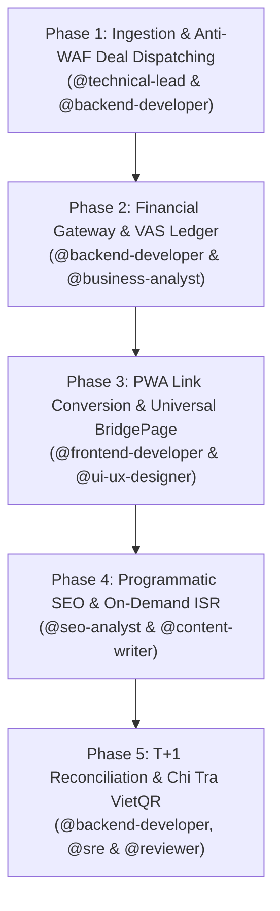

# Workflow: Affiliate Tri-Engine Lifecycle (`affiliate-tri-engine-lifecycle`)

> **Workflow Version**: 5.0.0 · **Pack**: `packs/affiliate-cashback-team` · **Target Platforms**: `cashback.example.com` & `app.cashback.example.com`  
> **Schema Contracts**: `contracts/schemas/feature-ticket.json`, `contracts/schemas/api-contract-spec.json`, `contracts/schemas/implementation-result.json`, `contracts/schemas/period-end-closing-report.json`, `contracts/schemas/content-handoff.json`, `contracts/schemas/seo-audit-report.json`

---

## 1. Overview

Quy trình đa tác nhân (Multi-Agent Swarm Workflow) điều phối toàn bộ vòng đời khép kín của Hệ sinh thái CashbackHub Tri-Engine: Từ thu thập deal và voucher qua crawler giả lập TLS Chrome 124+, xử lý sổ cái kép kế toán Việt Nam (VAS 1010-5010) và đối soát T+1, chuyển đổi người dùng qua PWA Chatbot 1-1 & BridgePage < 20KB, đến phủ sóng tự động 4 cụm từ khóa Programmatic SEO trên Next.js 15 ISR.

---

## 2. Prerequisites

Trước khi kích hoạt chu trình vận hành Tri-Engine Lifecycle, toàn bộ các điều kiện tiên quyết sau đây phải được thỏa mãn:

1. **Hạ Tầng Dịch Vụ Sẵn Sàng (Cluster & Infrastructure Ready)**:
   - Cụm K3s Kubernetes đang hoạt động bình thường trên node chỉ định.
   - Cơ sở dữ liệu PostgreSQL 16 đã hoàn thành migration Alembic (bảng `ledger_entries`, `accounts`, `users`, `orders`, `withdrawals`).
   - Redis 7 in-memory cache phản hồi lệnh `PING` với độ trễ < 2ms.
2. **Khóa Bí Mật & Biến Môi Trường (Secrets & Environment Tokens)**:
   - `INTERNAL_SYNC_KEY` đã được đồng bộ giữa `deal-bot-dispatcher` và `cashback-api-gateway`.
   - `ACCESSTRADE_API_TOKEN` hợp lệ với hạn mức token-bucket 30 req/min.
   - `TELEGRAM_BOT_TOKEN`, `ZALO_OA_SECRET`, `MOMO_PARTNER_CODE`, `MOMO_SECRET_KEY` được nạp qua K3s secret.
   - Chứng chỉ số RS256 Service Account cho Google Indexing API và khóa Bing IndexNow API key.
3. **Danh Sách Trắng Domain (Domain Whitelist Lock)**:
   - Toàn bộ routing xác nhận chỉ trỏ về `https://cashback.example.com` và `https://app.cashback.example.com`.

---

## 3. Workflow Steps & Execution Phases

### Phase 1: Ingestion & Anti-WAF Deal Dispatching (`deal-bot-dispatcher`)
- **Chủ trì**: `@technical-lead` & `@backend-developer`
- **Mục tiêu**: Deal Scraper & Anti-WAF Ingestion
- **Nhiệm vụ chi tiết**:
  1. Kích hoạt `ContinuousVoucherScheduler` theo chu kỳ 900s $\pm$ 60s jitter để phân tán tải truy vấn.
  2. Thu thập mã giảm giá qua AccessTrade Coupon API (Rate limit 30 req/min) và Shopee Promotion Scraper qua `curl_cffi` (Chrome 124+ JA3/JA4 fingerprint impersonation).
  3. Lọc giá ảo và chấm điểm deal qua `AntiAnomalyScorer` (ngưỡng chấp thuận $\ge 7.0$).
  4. Tạo ảnh social canvas 800x800 qua Pillow với `ImageLifecycle` RAM safety (`Image.MAX_IMAGE_PIXELS = 16_000_000`).
  5. Phát sóng deal qua kênh Telegram (`aiogram v3`) và đồng bộ catalog voucher vào API Gateway qua `POST /api/v1/internal/vouchers/sync` mang chữ ký `INTERNAL_SYNC_KEY`.
- **Exit Gate**: Voucher delta được đồng bộ thành công vào cơ sở dữ liệu, Circuit Breaker ở trạng thái `CLOSED`.

### Phase 2: Financial Gateway & VAS Ledger (`cashback-api-gateway`)
- **Chủ trì**: `@backend-developer` & `@business-analyst`
- **Mục tiêu**: Double-Entry Ledger & T+1 Reconciliation
- **Nhiệm vụ chi tiết**:
  1. Ghi nhận giao dịch mua hàng $T_0$ vào Sổ cái kép: Nợ TK 1010 / Có TK 2010 (80% hoàn tiền người dùng) và Có TK 3010 (20% biên lợi nhuận nền tảng).
  2. Cập nhật Redis 7 Dual-Key Logical TTL: `vouchers:brand:{slug}` (24h data) và `:ttl` (900s revalidation mark) chống hiện tượng cache stampede.
  3. Kích hoạt webhook HMAC-SHA256 `/api/revalidate-vouchers` sang `pseo-nextjs-engine`.
  4. Đảm bảo bất biến cân bằng tuyệt đối $\sum \text{Debit} \equiv \sum \text{Credit}$ trên mọi giao dịch (`LedgerUnbalancedException` bảo vệ).
- **Exit Gate**: Giao dịch ghi sổ thành công, `LedgerUnbalancedException` không bị kích hoạt, cache Redis được cập nhật.

### Phase 3: PWA Link Conversion & Universal BridgePage (`cashback-pwa-web`)
- **Chủ trì**: `@frontend-developer` & `@ui-ux-designer`
- **Mục tiêu**: Conversational PWA & Affiliate Chatbot (Acorn Mascot)
- **Nhiệm vụ chi tiết**:
  1. Trợ lý Chatbot 1-1 với linh vật đại diện Acorn Mascot tự động bắt link Shopee từ clipboard hoặc query param, bóc tách sản phẩm và trả về thẻ hoàn tiền trong $< 1$s.
  2. Chuyển hướng người dùng qua Universal BridgePage (`/go/:id`) với tổng kích thước bundle chunk $< 20$ KB.
  3. Kích hoạt hiệu ứng đếm ngược 2.0s lò xo Emil Spring ($m=1.0, k=300, c=30$) và lưu SubID 4 cấp (`sub1`-`sub4`) vào Cookie 7 ngày + LocalStorage.
  4. Mở app Shopee native qua URI scheme `shopeevn://`, tự động kích hoạt máy trạng thái 5 bước (Fallback Prompt) nếu in-app browser của Facebook/Zalo chặn mở app.
- **Exit Gate**: BridgePage tải $< 20$ KB, SubID được bảo lưu trọn vẹn, người dùng chuyển app Shopee thành công.

### Phase 4: Programmatic SEO & On-Demand ISR (`pseo-nextjs-engine`)
- **Chủ trì**: `@seo-analyst` & `@content-writer`
- **Mục tiêu**: Programmatic SEO & Fast Indexing
- **Nhiệm vụ chi tiết**:
  1. Tạo lập và cập nhật landing pages thuộc 4 cụm từ khóa (`/ma-giam-gia/`, `/danh-gia/`, `/so-sanh/`, `/lich-su-gia/`).
  2. Đảm bảo chỉ số Core Web Vitals LCP $< 1.2$s và CLS $= 0$ nhờ biểu đồ lịch sử giá vector SVG thuần `PriceHistorySvg.tsx`.
  3. Xuất bản cấu trúc dữ liệu Schema.org JSON-LD `@graph` đầy đủ thực thể (`WebSite`, `Organization`, `Product`, `Offer`, `AggregateRating`, `FAQPage`).
  4. Gửi yêu cầu lập chỉ mục tức thì qua Bing IndexNow (batch tối đa 10,000 URLs) và Google Indexing API (RS256 JWT).
- **Exit Gate**: Trang render thành công, Rich Snippet hợp lệ, URL được gửi lên Indexing API.

### Phase 5: T+1 Reconciliation & Chi Tra VietQR (`cashback-api-gateway`)
- **Chủ trì**: `@backend-developer`, `@sre` & `@reviewer`
- **Mục tiêu**: K3s / Edge Operations & Health Gating
- **Nhiệm vụ chi tiết**:
  1. Nhận file đối soát kỳ Shopee/AccessTrade, băm mã SHA-256 toàn bộ file chống xử lý trùng lặp (`DuplicateReconciliationFileException`).
  2. Kết chuyển tiền hoàn: Nợ TK 2010 / Nợ TK 3010 / Có TK 1010, đồng thời Nợ TK 1020 / Có TK 2020 / Có TK 4010.
  3. Xử lý nợ clawback: Nếu tài khoản người dùng có nợ trên TK 1030 (Contra-Asset), tự động cấn trừ trước khi chuyển vào TK 2020 khả dụng.
  4. Khi người dùng tạo yêu cầu rút tiền: Khóa dòng `with_for_update` trên TK 2020, chuyển vào ký quỹ TK 2040, tự động chi qua VietQR Napas 247 (lệnh $\le 500$k VND) hoặc chuyển duyệt HITL Telegram.
- **Exit Gate**: Tiền về tài khoản ngân hàng người dùng, số dư TK 2020 $\ge 0$, sổ cái cân bằng 100%.

---

## 4. Failure Modes & Mitigations

| Tình Huống Sự Cố (Failure Mode) | Triệu Chứng Nhận Biết | Biện Pháp Giảm Thiểu Tức Thì (Mitigation) | Cơ Chế Tự Phục Hồi (Self-Healing) |
|---|---|---|---|
| **WAF Anti-Bot Soft Ban / JA3-JA4 Drift** | Shopee trả về HTTP 403 Forbidden hoặc captcha challenge liên tục. | Circuit Breaker 3-strike chuyển sang `OPEN`, tạm dừng crawler 600s; loại bỏ proxy lỗi khỏi pool; tự động chuyển sang AccessTrade Coupon API làm nguồn dự phòng. | Sau 600s chuyển sang `HALF-OPEN`, thử nghiệm 1 request với proxy mới trước khi mở lại hoàn toàn. |
| **Ledger Imbalance / Concurrency Double Spending** | Lệch số dư giữa Debit và Credit hoặc người dùng tạo nhiều yêu cầu rút tiền song song. | Ném ngoại lệ `LedgerUnbalancedException` và rollback toàn bộ DB transaction; bắt buộc sử dụng khóa dòng mức database `with_for_update()` trên TK 2020. | Cơ sở dữ liệu tự động hủy giao dịch không cân bằng, bảo vệ tuyệt đối tính toàn vẹn tài chính. |
| **Post-Audit Clawback on Zero-Balance User** | Shopee đòi lại hoa hồng sau khi người dùng đã rút hết tiền khả dụng (TK 2020 = 0 VND). | Ghi nhận nợ vào tài khoản Contra-Asset 1030 và cập nhật `user.clawback_debt`; nghiêm cấm ghi âm TK 2020; tự động cấn trừ trên các đơn hàng mới trong tương lai. | Khi đơn hàng mới hoàn thành, hệ thống tự động cấn trừ Nợ TK 2020 / Có TK 1030 trước khi tăng số dư ví. |
| **Duplicate T+1 Reconciliation Import** | Người vận hành upload lại file đối soát đã xử lý trước đó. | Băm SHA-256 toàn bộ nội dung file và kiểm tra trùng lặp trong cơ sở dữ liệu; raise `DuplicateReconciliationFileException` và chặn xử lý. | Chặn đứng tức thì tại tầng service trước khi bất kỳ bút toán nào được ghi nhận. |
| **BridgePage Network Stall / In-App Browser Block** | Người dùng mở link từ Zalo/Facebook bị kẹt màn hình trắng hoặc không mở được app Shopee. | Giữ ngân sách bundle $< 20$ KB; máy trạng thái 5 bước tự động hiện nút mở ngoài và khay hướng dẫn sau 2.5s; lưu SubID vào cả Cookie và LocalStorage. | Fallback sang mở trình duyệt mặc định hệ thống kèm hướng dẫn copy link. |
| **Search Engine Indexing API Quota Exhaustion** | Google Indexing API hết hạn ngạch 200 URLs/ngày. | Phân cấp ưu tiên: Chỉ gửi Google Indexing API cho các trang deal hot và voucher flash sale mới; toàn bộ các trang còn lại định tuyến qua Bing IndexNow (10,000 URLs/ngày) và sitemap.xml. | Tự động xếp hàng URL vào Redis Queue để gửi lại vào ngày hôm sau khi hạn ngạch làm mới. |

---

## 5. Output Contracts

Toàn bộ các chuyển giao giữa các vai trò trong quy trình bắt buộc phải tuân theo cấu trúc JSON Schema chuẩn hóa:

* **`contracts/schemas/feature-ticket.json`** — Bản mô tả yêu cầu tính năng chi tiết cho từng giai đoạn phát triển vi dịch vụ.
* **`contracts/schemas/api-contract-spec.json`** — Đặc tả hợp đồng API và schemas trao đổi dữ liệu giữa 4 microservices.
* **`contracts/schemas/implementation-result.json`** — Kết quả thực thi kèm bằng chứng log và số liệu kiểm thử tự động.
* **`contracts/schemas/period-end-closing-report.json`** — Báo cáo quyết toán đối soát kỳ T+1 và xác thực cân bằng sổ cái kép VAS.
* **`contracts/schemas/content-handoff.json`** — Bàn giao nội dung bài đánh giá, so sánh, và metadata voucher chuẩn Answer-First.
* **`contracts/schemas/seo-audit-report.json`** — Báo cáo kiểm toán SEO, Core Web Vitals và tính toàn vẹn của đồ thị Schema.org JSON-LD.

---

## 6. Security Guardrails (OWASP ASI)

Hệ thống CashbackHub triển khai 6 chốt chặn an ninh mạng theo bộ khung bảo mật OWASP Top 10 for Agentic Systems (OWASP ASI):

* **ASI01 Goal Hijack**: Các tiến trình Deal bot và scraper chỉ được phép truy vấn các domain đã được phê duyệt trong danh sách trắng (`affiliate.example.com`, `network.example.com`, `cashback.example.com`). Tuyệt đối cấm crawler thực thi javascript tùy ý hoặc redirect sang domain bên ngoài không xác thực.
* **ASI02 Tool Misuse & Execution Boundaries**: Dịch vụ chi trả VietQR Napas 247 phải áp dụng giới hạn cứng (tối đa 500,000 VND/lệnh và 1,000,000 VND/ngày cho duyệt tự động). Mọi lệnh vượt ngưỡng hoặc tài khoản ngân hàng mới liên kết bắt buộc chuyển sang quy trình phê duyệt người thực (HITL) qua Telegram bot.
* **ASI03 Identity & Privilege Abuse**: Tách biệt hoàn toàn quyền truy cập giữa các microservices. Không lưu trữ mật khẩu trần hay khóa bí mật trong git repository. Mọi thông tin nhạy cảm phải nạp qua biến môi trường hoặc K3s secrets; phân quyền truy cập database theo nguyên tắc đặc quyền tối thiểu (least privilege).
* **ASI05 RCE & Unauthorized Mutation**: Bảng sổ cái kép kế toán là bất biến (Append-Only). Tuyệt đối cấm thực thi câu lệnh SQL `UPDATE` hoặc `DELETE` trên các bản ghi nhật ký giao dịch đã ghi sổ. Mọi điều chỉnh kế toán bắt buộc thực hiện qua bút toán đảo (Reversal Journal Entry).
* **ASI06 Context & Data Poisoning**: Kiểm tra nghiêm ngặt kiểu dữ liệu qua Pydantic V2 trên API Gateway và TypeScript strict trên Frontend, ngăn chặn injection mã độc XSS hoặc JSON-LD injection từ dữ liệu cào marketplace vào pSEO engine hoặc PWA client.
* **ASI09 Human-Agent Trust Exploitation**: Duy trì chuỗi bằng chứng mật mã không thể chối cãi: Băm SHA-256 toàn bộ file đối soát T+1, chữ ký HMAC-SHA256 trên webhook MoMo/AccessTrade, và mã tham chiếu giao dịch ngân hàng Napas FT.

---

## 7. Checklist

Các kỹ sư vận hành và tác nhân Swarm phải hoàn thành checklist sau trước khi phê duyệt chuyển giao:

- [ ] **Phase 1 Ingestion Check**: Scraper sử dụng đúng TLS fingerprint Chrome 124+, Circuit Breaker hoạt động, deal score $\ge 7.0$.
- [ ] **Phase 2 VAS Ledger Check**: Toàn bộ bút toán cân bằng $\sum Dr \equiv \sum Cr$, không xuất hiện `LedgerUnbalancedException`.
- [ ] **Phase 3 PWA Client Check**: Kích thước bundle BridgePage $< 20$ KB, SubID 4 cấp được ghi nhận vào Cookie và LocalStorage.
- [ ] **Phase 4 pSEO Engine Check**: Điểm Core Web Vitals CLS $= 0$ và LCP $< 1.2$s, Schema.org JSON-LD `@graph` hợp lệ.
- [ ] **Phase 5 T+1 Payout Check**: File đối soát được kiểm tra mã băm SHA-256, số dư TK 2020 $\ge 0$, lệnh rút có khóa dòng `with_for_update`.
- [ ] **Bảo Mật OWASP Check**: Không vi phạm 6 chốt chặn ASI01, ASI02, ASI03, ASI05, ASI06, ASI09.

---

## 8. Related Workflows

* `core/workflows/git-workflow.md` — Quy trình phân nhánh và tích hợp mã nguồn Git.
* `core/workflows/production-deployment.md` — Quy trình phát hành ứng dụng lên môi trường production K3s.
* `core/workflows/database-migration-lifecycle.md` — Quy trình thực hiện migration cơ sở dữ liệu với Alembic.
* `core/workflows/incident-response.md` — Quy trình ứng phó và xử lý sự cố khẩn cấp.

---

## 9. Related Skills

* `core/skills/backend/fastapi/` — Kỹ năng phát triển ứng dụng FastAPI chuẩn 2027 SOTA.
* `core/skills/frontend/react-pwa/` — Kỹ năng tối ưu hóa ứng dụng Progressive Web Apps với React và Service Worker.
* `core/skills/seo/programmatic-seo/` — Kỹ năng xây dựng kiến trúc SEO theo quy mô lớn với Next.js ISR.
* `core/skills/financial/double-entry-accounting/` — Kỹ năng thiết kế hệ thống sổ cái kép kế toán doanh nghiệp.
* `core/skills/scraping/anti-waf-tls/` — Kỹ năng thu thập dữ liệu web vượt rào cản WAF và Cloudflare Bot Management.
