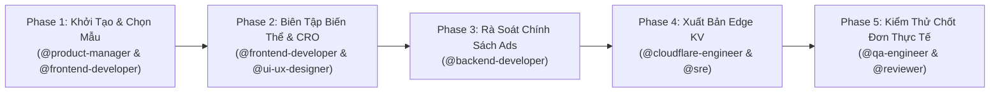

# Workflow: Landing Page Creation & Publishing Lifecycle (`landing-page-creation-lifecycle`)

> **Workflow Version**: 5.0.0 · **Pack**: `packs/landing-pages-team` · **Target Platform**: `landing-builder.example.com`  
> **Schema Contracts**: `contracts/schemas/feature-ticket.json` & `contracts/schemas/ui-component-spec.json`

---

## 1. Overview

Quy trình đa tác nhân (Multi-Agent Swarm Workflow) điều phối toàn bộ vòng đời khởi tạo, biên tập cấu hình biến thể 2 chiều, rà soát an toàn quảng cáo (Aho-Corasick Ad Policy Scanner), đồng bộ Cloudflare Edge KV và kiểm thử chốt đơn thực tế cho nền tảng Landing Pages.

---

## 2. Các Giai Đoạn Thực Thi Chi Tiết (Execution Phases)

### Phase 1: Khởi Tạo & Chọn Mẫu Giao Diện (Template Selection)
- **Chủ trì**: `@product-manager` & `@frontend-developer`
- **Nhiệm vụ**:
  1. Hướng dẫn merchant chọn 1 trong 5 mẫu giao diện chuẩn CRO:
     - `universal-classic`: Đồ gia dụng, thời trang, mẹ & bé.
     - `clinical-trust`: Dược mỹ phẩm, thực phẩm chức năng, nha khoa.
     - `flash-sale-urgency`: Chương trình xả kho, đồng giá, săn sale giới hạn.
     - `luxury-dark`: Đồng hồ, trang sức, thời trang cao cấp.
     - `story-provenance`: Đặc sản nông nghiệp, thủ công mỹ nghệ, thương hiệu gia truyền.
  2. Xác định subdomain merchant độc nhất (ví dụ: `shop-vip.landing-builder.example.com`).
- **Tiêu chí hoàn thành (Exit Gate)**: Bản ghi Site DRAFT được tạo lập trong cơ sở dữ liệu với `is_published: false`.

### Phase 2: Biên Tập Nội Dung, Ma Trận Biến Thể & Bản Địa Hóa
- **Chủ trì**: `@frontend-developer` & `@ui-ux-designer`
- **Nhiệm vụ**:
  1. Thiết lập hình ảnh Hero, thư viện ảnh (Gallery) và phân loại sản phẩm.
  2. Kích hoạt Ma trận biến thể 2 chiều (Màu sắc $\times$ Size 35-44+) hoặc áp dụng Preset 1-chạm ngành hàng.
  3. Cấu hình Bảng đo kích thước chân (`<dialog id="size-guide-modal">`).
  4. Cấu hình nút nổi liên hệ Zalo (`https://zalo.me/<phone>`) và Facebook Messenger.
  5. Thiết lập chân trang uy tín: Địa chỉ kho hàng tại Việt Nam, hotline hỗ trợ, cam kết 1 đổi 1 và quyền kiểm tra hàng trước khi thanh toán.
- **Tiêu chí hoàn thành (Exit Gate)**: Dữ liệu cấu hình JSON lưu trữ an toàn qua `PUT /api/v1/sites/:id` mà không làm mất trạng thái xuất bản hiện hữu.

### Phase 3: Rà Soát Chính Sách Quảng Cáo Tự Động (AI Policy Scanner)
- **Chủ trì**: `@backend-developer`
- **Nhiệm vụ**:
  1. Thực thi bộ quét Aho-Corasick tại tầng `biz` rà soát toàn bộ tiêu đề, mô tả và nội dung cam kết.
  2. Phát hiện các từ ngữ vi phạm chính sách Facebook/TikTok Ads (từ ngữ cấm: "trị dứt điểm", "cam kết 100%", "thần dược"...).
  3. Cảnh báo trực quan trên giao diện soạn thảo nếu có rủi ro bị khóa tài khoản quảng cáo.
- **Tiêu chí hoàn thành (Exit Gate)**: Trang đạt chuẩn an toàn quảng cáo (0 vi phạm nghiêm trọng).

### Phase 4: Xuất Bản Lên Cloudflare Edge KV & Định Tuyến Host
- **Chủ trì**: `@cloudflare-engineer` & `@sre`
- **Nhiệm vụ**:
  1. Kích hoạt lệnh `POST /api/v1/sites/:id/publish`.
  2. Backend cập nhật `is_published = true`, `status = 'PUBLISHED'` vào MySQL và đẩy toàn bộ `SiteConfig` lên Cloudflare Edge KV (`SITES_KV`).
  3. Edge Worker giải phóng cache, sẵn sàng phục vụ Edge SSR tức thì với TTFB < 25ms.
  4. Hiển thị Hộp thoại Thành công (Success Sharing Surface): Copy link 1-chạm, Mã QR code để quét kiểm tra trên điện thoại, nút xem trang thực tế.
- **Tiêu chí hoàn thành (Exit Gate)**: URL `https://<subdomain>.landing-builder.example.com` trả về HTTP 200 OK từ Cloudflare Worker.

### Phase 5: Kiểm Thử Chốt Đơn & Bắn Đơn Telesale (Smoke Verification)
- **Chủ trì**: `@qa-engineer` & `@reviewer`
- **Nhiệm vụ**:
  1. Thực hiện đặt thử 1 đơn hàng (Lead Submission) qua form COD hoặc thanh toán VietQR Napas 247.
  2. Kiểm tra server-side zero-trust price engine: Tổng tiền đơn hàng được tính toán chính xác từ database.
  3. Xác thực tin nhắn Telegram Bot gửi về nhóm telesale hiển thị đầy đủ thuộc tính phân loại: `Màu: ... | Size: ...`.
  4. Xác thực số điện thoại hiển thị đúng chuẩn trên Dashboard (hoặc tự động che `0987.654.xxx` đối với gói Miễn phí từ đơn thứ 51).
- **Tiêu chí hoàn thành (Exit Gate)**: 100% luồng mua hàng và xử lý đơn thông suốt, không có lỗi phát sinh.
