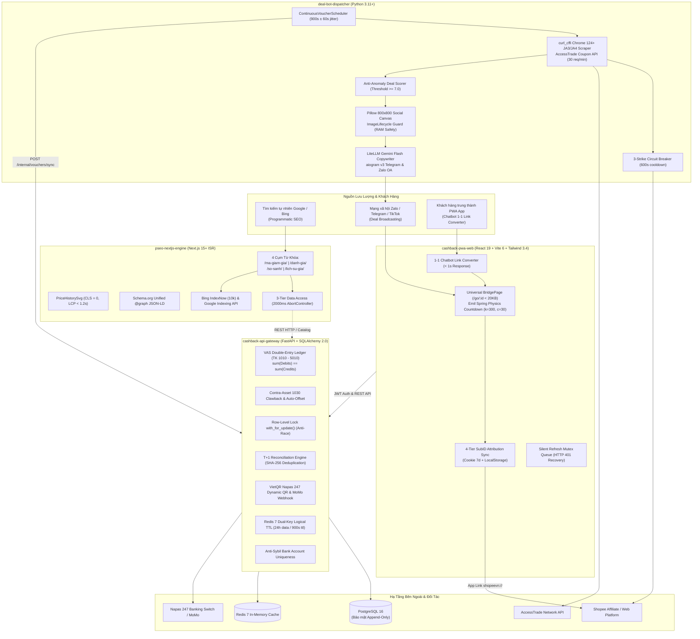

# Shoppe Team Pack (`shoppe-team`)

> **Version:** `5.0.0` · **Target System:** Tri-Engine Affiliate & Cashback Growth Engineering Platform (`motdeal.com` & `app.motdeal.com`)  
> **Repository:** [`shoppe`](https://github.com/vesviet-team/shoppe)  
> **Composition:** `core` + `overlays/seo-publishing` + `overlays/ui-design-system`  
> **Classification:** `confidential` · **EU AI Act Tier:** `minimal_risk`

---

## 1. Tổng Quan & Sứ Mệnh (Executive Overview & Mission)

Gói năng lực **`shoppe-team`** (v5.0.0) chuẩn hóa toàn diện quy trình kỹ thuật, kiến trúc phân tán, sổ cái tài chính kép kế toán Việt Nam (VAS), và cỗ máy tăng trưởng cho hệ sinh thái **MotDeal Tri-Engine** ([`motdeal.com`](https://motdeal.com) và [`app.motdeal.com`](https://app.motdeal.com)). 

Nền tảng vận hành mô hình hợp tác tiếp thị liên kết (Affiliate Marketing) và hoàn tiền thông minh (Cashback Loyalty) kết nối trực tiếp với sàn thương mại điện tử Shopee và mạng lưới AccessTrade:

* **Tri-Engine 4 Microservices Tự Vận Hành**: Kết nối chặt chẽ giữa bot thu thập deal thông minh (`deal-bot-dispatcher`), cổng giao dịch tài chính & sổ cái kế toán kép (`cashback-api-gateway`), ứng dụng PWA Chatbot chuyển đổi link 1-1 trên di động (`cashback-pwa-web`), và cỗ máy Programmatic SEO Next.js 15 ISR siêu tốc (`pseo-nextjs-engine`).
* **Kế Toán Kép Chuẩn VAS (Circular 200/133)**: Hệ thống tài khoản 1010–5010 bảo vệ cân bằng tài chính tuyệt đối $\sum \text{Debits} \equiv \sum \text{Credits}$, tài khoản Contra-Asset 1030 bảo toàn nợ hoàn tiền khi sàn truy thu (clawback), khóa mức dòng `with_for_update` chống gian lận rút tiền đồng thời.
* **T+1 Automated Reconciliation**: Đối soát kỳ tự động xử lý file CSV/Excel của Shopee/AccessTrade với chữ ký băm mật mã SHA-256 chống xử lý trùng lặp, giải phóng tiền hoàn ví tự động.
* **Thu Thập Deal Anti-WAF TLS Fingerprinting**: Sử dụng `curl_cffi` giả lập dấu vân tay trình duyệt Chrome 124+ (JA3/JA4), vượt qua Cloudflare/Akamai bot detection, bộ lọc giá ảo Anti-Anomaly Scorer ($\ge 7.0$), và tạo ảnh canvas mạng xã hội 800x800 an toàn bộ nhớ qua `ImageLifecycle`.
* **Trợ Lý PWA Chatbot 1-Chạm & Universal BridgePage < 20KB**: Chuyển đổi link Shopee dán từ clipboard sang link hoàn tiền trong dưới 1 giây; trang đệm BridgePage siêu nhẹ tải trong 200ms với vật lý đếm ngược lò xo Emil Spring, bảo toàn 4 cấp SubID (`sub1`–`sub4`) và tự động phục hồi lỗi in-app browser.
* **Programmatic SEO Đạt Tuyệt Đối Core Web Vitals**: Khai phá 4 cụm từ khóa mua sắm lớn với Next.js 15 App Router ISR, biểu đồ lịch sử giá vector SVG thuần (`PriceHistorySvg.tsx`) đạt CLS = 0 và LCP < 1.2s, xuất bản đồ thị Schema.org JSON-LD `@graph` hợp nhất, tự động ping Bing IndexNow và Google Indexing API.

---

## 2. Kiến Trúc Tri-Engine 4-Microservice (Architecture & Invariants)

Hệ thống MotDeal được thiết kế theo mô hình 4 vi dịch vụ (Microservices) phân tán, độc lập triển khai trên nền tảng K3s Kubernetes và Docker:



---

## 3. Năm Bất Biến Tài Chính VAS Bắt Buộc (The 5 VAS Financial Invariants)

Hệ thống kế toán hoàn tiền MotDeal tuân thủ nghiêm ngặt Luật Kế toán Việt Nam và Chuẩn mực Kế toán Doanh nghiệp (VAS Circular 200/2014/TT-BTC & Circular 133/2016/TT-BTC). Toàn bộ luồng giao dịch được bảo vệ bởi 5 bất biến toán học và quy tắc bất biến tại tầng cơ sở dữ liệu:

| Bất Biến | Tên Gọi & Định Nghĩa Toán Học | Vị Trí Mã Nguồn Thực Tế | Ngoại Lệ / Ràng Buộc Kiểm Soát | Kiểm Thử & Hành Động Xử Lý |
|---|---|---|---|---|
| **Invariant A** | **Cân Bằng Sổ Cái Kép (Balanced Ledger Parity)**<br>$\sum \text{Debit} \equiv \sum \text{Credit} \quad (\forall \text{ Giao dịch})$ | `cashback-api-gateway/src/services/ledger_engine.py:135-138` | `LedgerUnbalancedException("Ledger transaction out of balance...")` | Rollback toàn bộ transaction database ngay lập tức; không cho phép bất kỳ dòng nhật ký nào được ghi nhận đơn lẻ. |
| **Invariant B** | **Tài Khoản Contra-Asset 1030 & Tự Động Cấn Trừ Nợ Clawback**<br>Số dư ví khả dụng (TK 2020) không bao giờ bị âm. Khi sàn hủy hoa hồng mà ví rỗng, nợ ghi vào TK 1030 (VAS TK 1388). | `cashback-api-gateway/src/services/state_machine.py:322, 358-366`<br>`state_machine.py:280-295` | `chk_user_clawback_debt_positive`<br>`acc_1030` ghi nợ, `user.clawback_debt += debt` | Khi có đơn hoàn tiền mới, hàm `state_machine.py` tự động cấn trừ Nợ TK 2020 / Có TK 1030 trước khi giải phóng vào số dư khả dụng. Nợ quá 180 ngày trích lập dự phòng TK 5010 (VAS 2293) theo TT 48/2019/TT-BTC. |
| **Invariant C** | **Chống Race Condition Rút Tiền Bằng Khóa Dòng `with_for_update`**<br>Ngăn chặn tấn công chi tiêu kép (Double-Spending) khi người dùng gửi nhiều yêu cầu rút tiền song song. | `cashback-api-gateway/src/api/v1/withdrawals.py:151-156, 260, 269`<br>`state_machine.py:278, 335`<br>`vietqr_approval_service.py:493, 603` | SQL `SELECT ... FOR UPDATE` trên bản ghi người dùng | Luồng đầu tiên khóa dòng ví TK 2020 và chuyển sang ký quỹ TK 2040. Luồng thứ hai phải chờ, khi đọc lại thấy số dư không đủ và bị từ chối với HTTP 400 `InsufficientFundsException`. |
| **Invariant D** | **Độc Tôn Tên Miền Chính Thức (`motdeal.com`)**<br>Mọi liên kết, canonical URL, sitemap và metadata đều độc quyền trỏ về `https://motdeal.com` hoặc `https://app.motdeal.com`, không rò rỉ ra host lạ. | `pseo-nextjs-engine/src/app/layout.tsx:14-16`<br>`gitops/apps/shoppe/ingress.yaml:63, 89, 98` | Strict HSTS `max-age=63072000; includeSubDomains; preload` | Chặn đứng hành vi giả mạo tên miền (phishing) và phân tán sức mạnh SEO (link equity dilution). |
| **Invariant E** | **Sàn Không Âm Số Dư Ví Hoàn Tiền TK 2020 (Zero-Balance Floor)**<br>$\text{Balance}(\text{TK 2020}) \ge 0 \quad (\forall \text{ User, } \forall t)$ | `cashback-api-gateway/src/services/ledger_engine.py:165-169` | `NegativeBalanceException`<br>`chk_positive_available_balance` | Ràng buộc CHECK constraint tại mức bảng PostgreSQL ngăn cản mọi câu lệnh ghi nợ làm số dư khả dụng $< 0$. |

### Hệ Thống Tài Khoản Kế Toán Sổ Cái Kép MotDeal (VAS Chart of Accounts):
1. **TK 1010 (Phải thu hoa hồng trung gian - VAS TK 131)**: Hoa hồng ghi nhận tạm tính từ sàn Shopee/AccessTrade.
2. **TK 1020 (Tiền gửi ngân hàng thanh toán - VAS TK 112)**: Tài khoản thanh toán thực tế tại ngân hàng (VietinBank / Techcombank / MoMo).
3. **TK 1030 (Phải thu nợ hoàn tiền Clawback - VAS TK 1388)**: Tài khoản tài sản đối ứng (Contra-Asset) ghi nhận các khoản hoa hồng bị sàn truy thu khi số dư ví người dùng bằng 0.
4. **TK 2010 (Phải trả hoa hồng chờ duyệt - VAS TK 3388)**: Số tiền hoàn tạm giữ của người dùng chờ hết thời hạn đổi trả Shopee (T+30).
5. **TK 2020 (Phải trả ví tích lũy khả dụng - VAS TK 3388)**: Số dư tiền hoàn khả dụng người dùng có thể rút bất kỳ lúc nào.
6. **TK 2040 (Tiền ký quỹ rút đang xử lý - VAS TK 3388)**: Tiền người dùng yêu cầu rút đã khóa, đang chờ Napas 247 giải ngân.
7. **TK 3010 (Doanh thu hoa hồng chưa thực hiện - VAS TK 3387)**: Phần doanh thu sàn 20% giữ lại của nền tảng ở trạng thái chờ duyệt.
8. **TK 4010 (Doanh thu hoa hồng thuần thực hiện - VAS TK 5113)**: Doanh thu thực tế của MotDeal sau khi đối soát thành công T+1.
9. **TK 5010 (Dự phòng nợ clawback khó đòi - VAS TK 2293)**: Quỹ dự phòng rủi ro nợ khó đòi trích lập theo Thông tư 48/2019/TT-BTC cho các khoản nợ clawback quá hạn 180 ngày.

---

## 4. Ma Trận Phân Công 17 Vai Trò Tác Chiến (17 Operational Roles Matrix)

Hệ thống điều phối Swarm đa tác nhân phân bổ 17 vai trò tác chiến chuyên trách chịu trách nhiệm xuyên suốt 4 phân hệ vi dịch vụ:

| # | Mã Vai Trò | Tên Chuyên Môn | Trách Nhiệm Trọng Tâm Trong Hệ Sinh Thái MotDeal | Phân Hệ Phụ Trách |
|---|---|---|---|---|
| 1 | `@researcher` | Codebase & Market Researcher | Phân tích cơ chế tracking Shopee Affiliate, chính sách hoa hồng, giải pháp anti-WAF TLS fingerprinting và cập nhật API mạng lưới. | Nghiên cứu chung / Crawler |
| 2 | `@reviewer` | Code Reviewer & Integrity Auditor | Kiểm duyệt chất lượng pull request, kiểm soát tính toàn vẹn của 5 bất biến kế toán VAS và xác thực các biện pháp phòng vệ OWASP ASI. | Cổng API & Sổ Cái |
| 3 | `@seo-analyst` | Technical SEO Analyst | Tối ưu hóa 4 cụm từ khóa programmatic SEO, Core Web Vitals (CLS=0, LCP<1.2s), cấu trúc Schema.org JSON-LD và tỷ lệ lập chỉ mục IndexNow. | `pseo-nextjs-engine` |
| 4 | `@product-manager` | Product Strategy Manager | Định hình chiến lược hoàn tiền, lộ trình phát triển tính năng, tối ưu hóa tỷ lệ chuyển đổi link qua Chatbot và quy hoạch trải nghiệm người dùng. | `cashback-pwa-web` |
| 5 | `@project-manager` | Engineering Project Manager | Quản lý tiến độ vòng đời Tri-Engine, điều phối các cột mốc sprint, kiểm soát ngân sách vận hành và tiêu chuẩn bàn giao kỹ thuật. | Quản trị dự án |
| 6 | `@business-analyst` | FinTech Business Analyst | Phân tích quy trình kinh doanh, biên lợi nhuận hoa hồng (80% user / 20% platform), mô hình đối soát T+1 và quy chuẩn khấu trừ thuế TNCN TT 111. | Cổng API & Kế toán |
| 7 | `@solution-architect` | Enterprise Solution Architect | Thiết kế kiến trúc tổng thể Tri-Engine 4 microservices, mô hình dữ liệu loosely-coupled, ranh giới dịch vụ và hợp đồng giao tiếp giữa các phân hệ. | Toàn hệ thống |
| 8 | `@technical-architect` | Infrastructure Technical Architect | Thiết kế hạ tầng K3s GitOps, chiến lược caching Redis dual-key logical TTL, kiến trúc bảo mật zero-trust và quy trình sao lưu dữ liệu. | Hạ tầng K3s & Gateway |
| 9 | `@technical-lead` | Engineering Technical Lead | Dẫn dắt kỹ thuật, định chuẩn quy tắc code clean, giám sát pipeline CI/CD, giải quyết rủi ro bot scraper và cơ chế Circuit Breaker. | `deal-bot-dispatcher` |
| 10 | `@backend-developer` | Core Backend Developer | Phát triển API FastAPI, SQLAlchemy 2.0, công cụ sổ cái kép VAS 1010-5010, cơ chế đối soát T+1 SHA-256 và cổng thanh toán VietQR Napas 247. | `cashback-api-gateway` |
| 11 | `@frontend-developer` | PWA & Client Developer | Xây dựng React 19 PWA, Chatbot link converter (< 1s), Universal BridgePage (< 20KB) với lò xo Emil Spring và Silent Refresh Mutex. | `cashback-pwa-web` |
| 12 | `@sre` | Site Reliability Engineer | Đảm bảo độ sẵn sàng 99.95%, giám sát Prometheus/Grafana, tự động sao lưu PostgreSQL gzip-9 14 ngày, xử lý sự cố Circuit Breaker. | Vận hành K3s / DB |
| 13 | `@system-engineer` | Systems & Network Engineer | Quản trị cụm homelab / VPS K3s, Ingress Nginx, cấu hình SSL Let's Encrypt tự động, điều phối pool proxy xoay vòng và mạng nội bộ. | Mạng & Máy chủ |
| 14 | `@task-planner` | Sprint & Task Planner | Lập kế hoạch chi tiết các nhiệm vụ kỹ thuật, phân tách công việc microservices theo đúng năng lực và ranh giới trách nhiệm. | Điều phối Swarm |
| 15 | `@teacher` | Technical Educator | Biên soạn tài liệu hướng dẫn vận hành hệ thống, quy chuẩn đối soát kỳ cho kế toán, cẩm nang xử lý sự cố và tài liệu API nội bộ. | Đào tạo & Tài liệu |
| 16 | `@content-manager` | Content & Campaign Manager | Quản lý danh mục bài viết đánh giá, so sánh, săn sale, điều phối nội dung copywriting AI flash sale và giám sát lịch phát sóng deal. | Quản trị nội dung |
| 17 | `@content-writer` | Technical & Copywriter | Biên soạn nội dung chuẩn Answer-First cho các cụm pSEO, thông báo khuyến mãi Telegram/Zalo và kịch bản hội thoại Chatbot. | Nội dung pSEO / Copy |

### Các Vai Trò Chuyên Môn Bổ Trợ (Specialist Roles):
* **`@vietnam-accounting-specialist`**: Thẩm định tính tuân thủ Chuẩn mực Kế toán Việt Nam (VAS Circular 200/133), xử lý trích lập dự phòng Thông tư 48, thuế TNCN Thông tư 111.
* **`@ui-ux-designer`**: Thiết kế hệ thống nhận diện thương hiệu MotDeal, linh vật Sóc Mót, bảng màu Warm Canvas & Shopee Accent, layout BridgePage chuẩn công thái học di động.

---

## 5. Bản Sắc Thương Hiệu & Hệ Thống Thiết Kế (Brand Identity & UI Design System)

Giao diện người dùng của hệ sinh thái MotDeal kế thừa và mở rộng từ `overlays/ui-design-system`, hướng tới phong cách hiện đại, ấm áp và đáng tin cậy:

* **Linh Vật Thương Hiệu (Brand Mascot)**: **Sóc Mót** — chú sóc thông minh, nhanh nhẹn, chăm chỉ tích lũy từng hạt dẻ (tượng trưng cho từng đồng tiền hoàn và mã giảm giá tích lũy cho người dùng).
* **Bảng Màu Chủ Đạo (Color Palette)**:
  - **Warm Canvas (`#FBF9F5`)**: Màu nền ấm áp chủ đạo, dịu mắt, thay thế nền trắng chói truyền thống.
  - **Shopee Accent Orange (`#EE4D2D`)**: Màu cam Shopee nhận diện cao, dùng cho nút Call-To-Action chính, huy hiệu giảm giá sốc.
  - **Acorn Gold (`#D97706` / `#F59E0B`)**: Màu vàng quả sồi tượng trưng cho tiền hoàn tích lũy, điểm thưởng và sự thịnh vượng.
  - **Slate (`#0F172A`)**: Màu xanh đen phiến đá dùng cho tiêu đề chính, tạo độ tương phản cao và cảm giác vững chãi.
  - **Charcoal (`#1F2937`)**: Màu than chì mềm mại dùng cho văn bản thân bài (tuyệt đối không sử dụng màu đen thuần `#000000`).
* **Quy Chuẩn Hiệu Năng Giao Diện (Performance Budget)**:
  - **BridgePage Bundle Budget**: Tổng kích thước bundle trang `/go/:id` nghiêm ngặt dưới 20 KB (thực tế: 19.36 KB uncompressed, 6.11 KB Gzip) để hiển thị tức thì trên mạng di động 3G/4G yếu.
  - **Emil Spring Physics**: Chuyển động đếm ngược mượt mà sử dụng mô phỏng vật lý dao động điều hòa có cản ($m=1.0, k=300, c=30, \zeta \approx 0.866$).
  - **Zero Cumulative Layout Shift (CLS = 0)**: Đồ thị giá vector SVG tĩnh không làm nhảy bố cục trang khi tải dữ liệu.

---

## 6. Tiêu Chuẩn Vận Hành, Tuân Thủ & Bảo Mật (Compliance & Security)

### Tuân Thủ Pháp Lý & Trí Tuệ Nhân Tạo (Regulatory Compliance)
* **EU AI Act Tier**: `minimal_risk` — Trợ lý phân loại deal và tạo copy nội dung không thuộc danh mục rủi ro cao, có sự giám sát của con người.
* **Quy Trình Phê Duyệt Người Thực (Human-in-the-Loop Gate Actions)**:
  1. `run_migration`: Chạy migration cấu trúc cơ sở dữ liệu.
  2. `push_to_production`: Phát hành phiên bản mới lên môi trường production.
  3. `modify_secrets`: Chỉnh sửa biến môi trường và mật mã bảo mật.
  4. `approve_large_withdrawal`: Phê duyệt thủ công các lệnh rút tiền trên 500,000 VND hoặc tài khoản mới.
  5. `execute_period_end_closing`: Khóa sổ kế toán kỳ đối soát T+1 và quyết toán doanh thu.

### Tiêu Chuẩn Phòng Vệ An Ninh Mạng OWASP ASI
* **ASI01 Goal Hijack**: Crawler bị giới hạn cứng chỉ được truy cập danh sách domain được phê duyệt (`shopee.vn`, `accesstrade.vn`, `motdeal.com`).
* **ASI02 Tool Misuse**: Cổng thanh toán VietQR Napas 247 giới hạn tự động tối đa 500,000 VND/lệnh và 1,000,000 VND/ngày.
* **ASI03 Identity & Privilege Abuse**: Tách biệt hoàn toàn quyền hạn giữa 4 microservices; sử dụng token HMAC-SHA256 có thời hạn và mã hóa Argon2id.
* **ASI05 RCE & Unauthorized Mutation**: Bảng nhật ký sổ cái kế toán là bất biến (Append-Only); nghiêm cấm các lệnh SQL `UPDATE`/`DELETE` trên sổ cái.
* **ASI06 Context & Data Poisoning**: Kiểm tra kiểu dữ liệu nghiêm ngặt qua Pydantic V2 và TypeScript strict, ngăn chặn XSS và JSON-LD injection từ dữ liệu cào Shopee.
* **ASI09 Human-Agent Trust Exploitation**: Lưu vết kiểm toán SHA-256 toàn bộ file đối soát T+1 và mã tham chiếu giao dịch ngân hàng Napas FT.

---

## 7. Lệnh Kiểm Chứng Tại Môi Trường Cục Bộ (Local Verification Commands)

Trước khi đề xuất commit hoặc báo hoàn thành nhiệm vụ, các kỹ sư vận hành bắt buộc phải thực thi các lệnh kiểm chứng sau:

```bash
# 1. Kiểm tra tính hợp lệ của manifest các packs trong platform (Yêu cầu 17 packs pass)
python core/scripts/validate-packs.py

# 2. Kiểm tra tính đồng bộ của các bộ chỉ mục (skills, roles, packs README)
python core/scripts/validate-indexes.py

# 3. Chạy toàn bộ 17 bộ validator tự động của platform agent-skills
python core/scripts/validate-all.py

# 4. Chạy bộ kiểm thử thách thức toàn diện dành riêng cho shoppe-team
pytest tests/test_shoppe_pack_challenge.py -v
```
