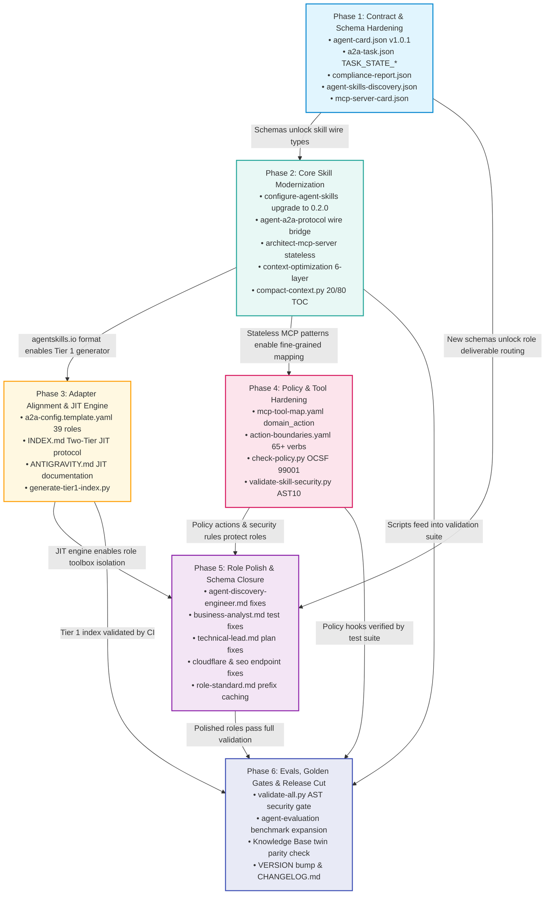

# Production Upgrade Roadmap: 2026–2027 SOTA Modernization

> **Document Type:** Master Production Upgrade Roadmap & Phased Implementation Plan  
> **Target Repository:** `agent-skills` (`d:\myproject\agent-skills`)  
> **Baseline Codebase:** `v5.7.3` (A2A 1.0 + Antigravity Adapter)  
> **Target Release Track:** `v5.8.0` (Minor Feature & Protocol Bridge) $\longrightarrow$ `v6.0.0` (Major Architecture & JIT Engine)  
> **Author:** `worker_roadmap_m2` (Production Release Architect)  
> **Governing Specifications:** AAIF A2A v1.0.1+, MCP Revision 2026-07-28 (Stateless HTTP), agentskills.io 0.2.0 (RFC 8615), OWASP ASI01–ASI10 (2026), OWASP AST01–AST10 (v1.0-2027), JSON Schema Draft 2020-12, OCSF 99001  
> **Date:** November 2026  
> **Status:** Production-Ready / Milestone M2 Authoritative Deliverable  

---

## Table of Contents

1. [Executive Overview & Release Strategy](#1-executive-overview--release-strategy)
   - [1.1 Baseline Codebase Context (v5.7.3)](#11-baseline-codebase-context-v573)
   - [1.2 Modernization Imperatives Across 8 SOTA Standards](#12-modernization-imperatives-across-8-sota-standards)
   - [1.3 Two-Stage Release Vehicle Architecture (v5.8.0 vs v6.0.0)](#13-two-stage-release-vehicle-architecture-v580-vs-v600)
   - [1.4 Non-Negotiable Architectural Invariants](#14-non-negotiable-architectural-invariants)
2. [Dependency Graph & Release Wave Architecture](#2-dependency-graph--release-wave-architecture)
   - [2.1 Master Phase Dependency DAG (Mermaid)](#21-master-phase-dependency-dag-mermaid)
   - [2.2 Release Wave Staging & Blast Radius Boundaries](#22-release-wave-staging--blast-radius-boundaries)
   - [2.3 Circuit Breaker & Automatic Rollback Policy](#23-circuit-breaker--automatic-rollback-policy)
3. [Phase 1: Contract & Schema Hardening](#3-phase-1-contract--schema-hardening)
   - [3.1 Objectives & Deliverable Inventory](#31-objectives--deliverable-inventory)
   - [3.2 Target File Modifications in Existing Schemas](#32-target-file-modifications-in-existing-schemas)
   - [3.3 Complete Draft 2020-12 Schema Definitions for New Contracts](#33-complete-draft-2020-12-schema-definitions-for-new-contracts)
     - [3.3.1 `compliance-report.json`](#331-compliance-reportjson)
     - [3.3.2 `agent-skills-discovery.json`](#332-agent-skills-discoveryjson)
     - [3.3.3 `mcp-server-card.json`](#333-mcp-server-cardjson)
   - [3.4 Verification Commands & Phase-Exit Gates](#34-verification-commands--phase-exit-gates)
4. [Phase 2: Core Skill & Governance Modernization](#4-phase-2-core-skill--governance-modernization)
   - [4.1 Objectives & Deliverable Inventory](#41-objectives--deliverable-inventory)
   - [4.2 Upgrading `configure-agent-skills` to agentskills.io 0.2.0](#42-upgrading-configure-agent-skills-to-agentskillsio-020)
   - [4.3 Dual-Stack Wire Transformers for `agent-a2a-protocol`](#43-dual-stack-wire-transformers-for-agent-a2a-protocol)
   - [4.4 MCP Stateless HTTP Transport Upgrades in `architect-mcp-server`](#44-mcp-stateless-http-transport-upgrades-in-architect-mcp-server)
   - [4.5 Deterministic 6-Layer Prefix Caching in `context-optimization`](#45-deterministic-6-layer-prefix-caching-in-context-optimization)
   - [4.6 Syntax-Aware Head-Tail TOC & Spillover in `compact-context.py`](#46-syntax-aware-head-tail-toc--spillover-in-compact-contextpy)
   - [4.7 AST10 Static Engine Integration in `skill-preflight-ast-check`](#47-ast10-static-engine-integration-in-skill-preflight-ast-check)
   - [4.8 Verification Commands & Phase-Exit Gates](#48-verification-commands--phase-exit-gates)
5. [Phase 3: Adapter Alignment & Two-Tier JIT Skill Discovery Engine](#5-phase-3-adapter-alignment--two-tier-jit-skill-discovery-engine)
   - [5.1 Objectives & Deliverable Inventory](#51-objectives--deliverable-inventory)
   - [5.2 Complete 39-Role Synchronization in `a2a-config.template.yaml`](#52-complete-39-role-synchronization-in-a2a-configtemplateyaml)
   - [5.3 Two-Tier JIT Architecture Specification for `INDEX.md` & `ANTIGRAVITY.md`](#53-two-tier-jit-architecture-specification-for-indexmd--antigravitymd)
   - [5.4 Lightweight Tier 1 Manifest Generator (`generate-tier1-index.py`)](#54-lightweight-tier-1-manifest-generator-generate-tier1-indexpy)
   - [5.5 Hybrid Candidate Ranking & Verification Algorithm](#55-hybrid-candidate-ranking--verification-algorithm)
   - [5.6 Verification Commands & Phase-Exit Gates](#56-verification-commands--phase-exit-gates)
6. [Phase 4: Policy-as-Code & MCP Tool Mapping Hardening](#6-phase-4-policy-as-code--mcp-tool-mapping-hardening)
   - [6.1 Objectives & Deliverable Inventory](#61-objectives--deliverable-inventory)
   - [6.2 Fine-Grained `<domain>_<action>` Prefix Resolution in `mcp-tool-map.yaml`](#62-fine-grained-domain_action-prefix-resolution-in-mcp-tool-mapyaml)
   - [6.3 Expanding `action-boundaries.yaml` Verbs & SVID Non-Human Identity](#63-expanding-action-boundariesyaml-verbs--svid-non-human-identity)
   - [6.4 Emitting OCSF 99001 Structured Audit Events in `check-policy.py`](#64-emitting-ocsf-99001-structured-audit-events-in-check-policypy)
   - [6.5 Automated Lethal Trifecta ($\mathcal{T}_{\text{lethal}}$) Security Gate in CI](#65-automated-lethal-trifecta-mathcalt_textlethal-security-gate-in-ci)
   - [6.6 Verification Commands & Phase-Exit Gates](#66-verification-commands--phase-exit-gates)
7. [Phase 5: Role Definition Polish & Contract Closure](#7-phase-5-role-definition-polish--contract-closure)
   - [7.1 Objectives & Deliverable Inventory](#71-objectives--deliverable-inventory)
   - [7.2 Reconciling Broken Deliverable Schema References Across Roles](#72-reconciling-broken-deliverable-schema-references-across-roles)
   - [7.3 Standardizing Discovery Endpoints in Cloudflare & SEO Roles](#73-standardizing-discovery-endpoints-in-cloudflare--seo-roles)
   - [7.4 Guardrail Lock Density Calibration ($12 \le \text{locks} \le 24$)](#74-guardrail-lock-density-calibration-12-le-textlocks-le-24)
   - [7.5 Prompt Prefix Caching Guidance Injection in `role-standard.md`](#75-prompt-prefix-caching-guidance-injection-in-role-standardmd)
   - [7.6 Verification Commands & Phase-Exit Gates](#76-verification-commands--phase-exit-gates)
8. [Phase 6: Automated Testing, Golden Evals & Release Cut](#8-phase-6-automated-testing-golden-evals--release-cut)
   - [8.1 Objectives & Deliverable Inventory](#81-objectives--deliverable-inventory)
   - [8.2 Expanding `validate-all.py` with SOTA Security & Schema Checks](#82-expanding-validate-allpy-with-sota-security--schema-checks)
   - [8.3 Expanding Golden Benchmark Evaluation Evals](#83-expanding-golden-benchmark-evaluation-evals)
   - [8.4 SOTA Architectural Knowledge Base Parity & Invariants](#84-sota-architectural-knowledge-base-parity--invariants)
   - [8.5 Release Cut Playbook (`VERSION`, `package.json`, `CHANGELOG.md`)](#85-release-cut-playbook-version-packagejson-changelogmd)
   - [8.6 Verification Commands & Phase-Exit Gates](#86-verification-commands--phase-exit-gates)
9. [Risk Register & Mitigation Matrix](#9-risk-register--mitigation-matrix)
   - [9.1 Risk Assessment Matrix](#91-risk-assessment-matrix)
   - [9.2 Backward-Compatibility Bridges & Dual-Stack Fallbacks](#92-backward-compatibility-bridges--dual-stack-fallbacks)
   - [9.3 Fail-Closed Containment & Blast Radius Limits](#93-fail-closed-containment--blast-radius-limits)
10. [Phase-Exit Criteria & Verification Playbook](#10-phase-exit-criteria--verification-playbook)
    - [10.1 Master Verification Command Reference](#101-master-verification-command-reference)
    - [10.2 Sequential Phase-by-Phase Exit Checklist](#102-sequential-phase-by-phase-exit-checklist)

---

## 1. Executive Overview & Release Strategy

### 1.1 Baseline Codebase Context (v5.7.3)

The `agent-skills` repository at version **5.7.3** represents an industry-leading multi-agent framework featuring:
* **39 Calibrated Roles**: Standardized across 16 core governance sections with strict decision boundaries and guardrail lock density ($12 \le \text{locks} \le 24$).
* **183 Active Skills**: 168 Core skills (`core/skills/`) plus 15 Modular Overlays (`overlays/`), each featuring explicit owner bindings and governance constraints.
* **25 Production Workflows**: Covering 4 discrete delivery categories (discovery, engineering, quality, release).
* **60 JSON Data Contracts**: Draft 2020-12 compliant schemas governing inter-agent data exchange.
* **17 Team Packs & 21 Overlays**: Composable capability configurations for diverse engineering environments.
* **100% CI Pass Rate**: 19 independent validator scripts passing with exit code 0 (`python core/scripts/validate-all.py`).

Despite these strengths, the baseline architecture relies on an internal adapter layer (Antigravity local method names, lowercase task status strings, line-based output clipping, and monolithic skill pre-loading) that must be modernized to interoperate seamlessly with emerging late-2026/2027 international agent engineering standards.

### 1.2 Modernization Imperatives Across 8 SOTA Standards

Based on the authoritative deep research conducted in `reports/RESEARCH_2026_2027_SOTA.md`, eight major architectural imperatives drive this production roadmap:

```
┌────────────────────────────────────────────────────────────────────────────────────────┐
│                        2026–2027 SOTA MODERNIZATION DRIVERS                            │
├───────────────────────────────┬────────────────────────────────────────────────────────┤
│ 1. agentskills.io 0.2.0       │ RFC 8615 discovery manifest, SHA-256 integrity digests,│
│    Discovery Standard         │ progressive disclosure, eliminaton of pre-loading bloat│
├───────────────────────────────┼────────────────────────────────────────────────────────┤
│ 2. AAIF A2A v1.0.1+ Protocol  │ Wire endpoints (message/send, message/stream), uppercase│
│    Lifecycle & Wire Streaming │ TASK_STATE_* enums, securitySchemes, google.rpc.Status │
├───────────────────────────────┼────────────────────────────────────────────────────────┤
│ 3. MCP 2026-07-28 Stateless   │ Abolish Mcp-Session-Id, per-request _meta, MRTR        │
│    HTTP Remote Architecture   │ (SEP-2322), domain-prefixed tool policy gates          │
├───────────────────────────────┼────────────────────────────────────────────────────────┤
│ 4. OWASP ASI01–ASI10 & AST10  │ CI-enforced preflight AST scanning, mathematical proof │
│    Zero-Trust Security Gates  │ blocking the Lethal Trifecta (T_lethal), 4-tier sandbox│
├───────────────────────────────┼────────────────────────────────────────────────────────┤
│ 5. Prompt Prefix Caching      │ Deterministic 6-layer static-to-dynamic prompt layout, │
│    Optimization Alignment     │ provider breakpoints, 85-90% TTFT reduction, 90% cost cut│
├───────────────────────────────┼────────────────────────────────────────────────────────┤
│ 6. Token Economics & TOC      │ Syntax-aware 20/80 Head-Tail TOC, spill-to-disk offload│
│    Truncation Engine          │ for payloads > 4 KB, 60/80 compaction gates            │
├───────────────────────────────┼────────────────────────────────────────────────────────┤
│ 7. Two-Tier JIT Skill         │ Tier 1 lightweight index (~40 tokens/skill) + Tier 2   │
│    Discovery Architecture     │ dynamic loading, hybrid BM25 + dense ranking           │
├───────────────────────────────┼────────────────────────────────────────────────────────┤
│ 8. Role Modularization &      │ 3-state Policy-as-Code lattice (39 roles x 65+ verbs), │
│    Boundary Hardening         │ Non-Human Identity (NHI) SVID binding, OCSF 99001 logs │
└───────────────────────────────┴────────────────────────────────────────────────────────┘
```

### 1.3 Two-Stage Release Vehicle Architecture (v5.8.0 vs v6.0.0)

To eliminate operational risk, prevent breaking changes for active production deployments, and ensure continuous test passage, the upgrade roadmap is partitioned into two distinct release milestones:

```
                                  RELEASE VEHICLE HORIZON
                                  
  [Baseline: v5.7.3]
          │
          ▼
  ┌─────────────────────────────────────────────────────────────────────────────┐
  │ RELEASE v5.8.0 (Minor Feature & Protocol Bridge Release)                    │
  │ Target Horizon: Q1 2027                                                     │
  │ Backward Compatibility: 100% Non-Breaking Dual-Stack Compatibility          │
  ├─────────────────────────────────────────────────────────────────────────────┤
  │ • Phase 1: Contract & Schema Hardening (A2A v1.0.1+ wire schemas, new cards)│
  │ • Phase 2: Core Skill & Governance Modernization (agentskills.io, AST CI)   │
  │ • Phase 3: Adapter Alignment & 39-Role Synchronization                      │
  │ • Phase 5: Role Definition Polish & Broken Deliverable Reference Fixes      │
  │ Core Achievement: Full wire interoperability with external A2A v1.0.1+      │
  │ agents while maintaining complete backward compatibility with Antigravity.  │
  └──────────────────────────────────────┬──────────────────────────────────────┘
                                         │
                                         ▼
  ┌─────────────────────────────────────────────────────────────────────────────┐
  │ RELEASE v6.0.0 (Major Architecture & JIT Engine Release)                    │
  │ Target Horizon: Q2 2027                                                     │
  │ Backward Compatibility: Deprecates legacy monolithic loading; introduces JIT│
  ├─────────────────────────────────────────────────────────────────────────────┤
  │ • Two-Tier JIT Skill Discovery Runtime (`generate-tier1-index.py`)          │
  │ • Syntax-Aware AST Tool Output Truncation & Disk Spillover                  │
  │ • Hardened `<domain>_<action>` MCP Policy Prefix Gate & OCSF 99001 Logging  │
  │ • Deprecation of legacy lowercase A2A states in favor of pure TASK_STATE_*  │
  │ Core Achievement: 97.3% reduction in catalog prompt bloat, sub-500ms TTFT, │
  │ and zero-trust mathematical execution containment.                          │
  └─────────────────────────────────────────────────────────────────────────────┘
```

### 1.4 Non-Negotiable Architectural Invariants

Throughout all execution phases, the following four platform laws MUST be strictly maintained:

1. **Dual-Stack Wire Translation Invariant**:
   All A2A schema modifications must support both the legacy Antigravity local bindings (`agent.invoke`, `agent.stream`, lowercase states) and the canonical AAIF A2A v1.0.1 wire operations (`message/send`, `message/stream`, uppercase `TASK_STATE_*`). No existing tool call or adapter configuration may break.
2. **The Single-Source-of-Identity (SSOI) Invariant**:
   For every skill $S$, its canonical folder name, its frontmatter `name`, and its manifest identifier in `index.json` and `role-skill-index.json` must be strictly identical:
   $$\text{DirName}(S) \equiv \text{FrontmatterName}(S) \equiv \text{ManifestID}(S)$$
3. **The Zero-Regress Validation Invariant**:
   No commit or release cut may be approved unless all 19 core validators (`python core/scripts/validate-all.py`) pass with exit code 0.
4. **Least-Agency & Policy Fail-Closed Invariant**:
   If an incoming action cannot be unambiguously matched to an explicit `allowed` permission rule in `action-boundaries.yaml`, the policy engine MUST fail closed and evaluate to `requires_approval` or `denied`. Default-permissive behavior is strictly prohibited.

---

## 2. Dependency Graph & Release Wave Architecture

### 2.1 Master Phase Dependency DAG (Mermaid)

The implementation sequence forms a strict Directed Acyclic Graph (DAG) where schema contracts form the foundational bedrock upon which skills, adapters, policies, roles, and validation suites depend:



### 2.2 Release Wave Staging & Blast Radius Boundaries

The six execution phases are organized into three sequential Release Waves, isolating failure domains and managing operational risk:

```
┌────────────────────────────────────────────────────────────────────────────────────────┐
│ WAVE 1: FOUNDATION CONTRACTS & CORE GOVERNANCE (Phases 1 & 2)                          │
├────────────────────────────────────────────────────────────────────────────────────────┤
│ Blast Radius: Purely additive schemas and internal skill instruction updates.         │
│ Impact: Zero breaking changes to existing Antigravity or CLI operations.              │
│ Validation Gate: `python core/scripts/validate-contracts.py` &&                       │
│                  `python core/scripts/validate-skills.py` (Exit code 0).               │
└───────────────────────────────────┬────────────────────────────────────────────────────┘
                                    │ Wave 1 Sign-Off
                                    ▼
┌────────────────────────────────────────────────────────────────────────────────────────┐
│ WAVE 2: PLATFORM ADAPTERS & RUNTIME SECURITY ENGINE (Phases 3 & 4)                     │
├────────────────────────────────────────────────────────────────────────────────────────┤
│ Blast Radius: Template synchronization, policy verb expansions, and AST scanner.      │
│ Impact: Syncs 14 missing roles in templates; enables domain-prefixed MCP policy check. │
│ Validation Gate: `python core/scripts/validate-policies.py` &&                        │
│                  `python core/scripts/validate-thirdparty-skills.py` (Exit code 0).    │
└───────────────────────────────────┬────────────────────────────────────────────────────┘
                                    │ Wave 2 Sign-Off
                                    ▼
┌────────────────────────────────────────────────────────────────────────────────────────┐
│ WAVE 3: ECOSYSTEM CLOSURE, INTEGRATION EVALS & RELEASE CUT (Phases 5 & 6)              │
├────────────────────────────────────────────────────────────────────────────────────────┤
│ Blast Radius: Role deliverable routing tables, golden evals, and repository version.  │
│ Impact: Fixes 5 broken schema references; bumps version to v5.8.0 / v6.0.0.            │
│ Validation Gate: `python core/scripts/validate-all.py` (19/19 PASS, Exit code 0).      │
└────────────────────────────────────────────────────────────────────────────────────────┘
```

### 2.3 Circuit Breaker & Automatic Rollback Policy

To ensure repository stability throughout execution, any phase encountering validation regressions must invoke the **Circuit Breaker Protocol**:

1. **Trigger Condition**:
   Any execution step causing `python core/scripts/validate-all.py` to exit with code $\ne 0$, or introducing syntax errors into existing JSON contracts, halts forward progress immediately.
2. **Blast Radius Isolation**:
   Edits are staged in discrete, single-file commits or isolated patches. No multi-phase batched edits may be applied simultaneously.
3. **Automated Rollback Action**:
   If a schema modification invalidates existing bundled examples or agent cards, the change is reverted to the baseline git SHA (`git checkout HEAD -- <file>`) and the schema is refactored using non-breaking schema unions (`anyOf` / `oneOf`).

---

## 3. Phase 1: Contract & Schema Hardening

### 3.1 Objectives & Deliverable Inventory

* **Objective**: Modernize the repository's JSON Schema Draft 2020-12 data contracts to support AAIF A2A v1.0.1+ wire streaming, uppercase monotonic task states, standard security schemes, and publish the three missing foundation schemas.
* **Target Version Alignment**: `v5.8.0`
* **Prerequisites**: Baseline `v5.7.3` clean test pass (`validate-contracts.py` 60/60 PASS).
* **Deliverable Inventory**:
  1. Modify `core/contracts/schemas/agent-card.json` (Wire compatibility & `securitySchemes`)
  2. Modify `core/contracts/schemas/a2a-task.json` (Monotonic `TASK_STATE_*` enums & timeout deprecation)
  3. Modify `core/contracts/schemas/a2a-task-progress.json` (A2A event names & state parity)
  4. Modify `core/contracts/schemas/a2a-jsonrpc-envelope.json` (Standard wire method enums)
  5. Modify `core/contracts/schemas/a2a-artifact.json` (Deprecate `kind`, unify Part structure)
  6. **Create** `core/contracts/schemas/compliance-report.json` (Agent readiness audit schema)
  7. **Create** `core/contracts/schemas/agent-skills-discovery.json` (agentskills.io 0.2.0 schema)
  8. **Create** `core/contracts/schemas/mcp-server-card.json` (MCP 2026-07-28 stateless server card)

### 3.2 Target File Modifications in Existing Schemas

#### 3.2.1 `core/contracts/schemas/agent-card.json`
* **Lines 24–27**: Replace rigid `"const": "1.0"` with regex pattern:
  ```json
  "protocol_version": {
    "type": "string",
    "pattern": "^1\\.[0-9]+(\\.[0-9]+)?$",
    "description": "AAIF A2A protocol semver string (e.g. '1.0', '1.0.1')."
  }
  ```
* **Lines 114–129**: Add `securitySchemes` and `supportedInterfaces` per A2A v1.0.1:
  ```json
  "securitySchemes": {
    "type": "object",
    "description": "Cryptographic authentication schemes supported by the agent.",
    "additionalProperties": {
      "type": "object",
      "properties": {
        "type": { "type": "string", "enum": ["http", "oauth2", "openIdConnect", "mutualTLS", "spiffe"] },
        "scheme": { "type": "string" },
        "bearerFormat": { "type": "string" },
        "description": { "type": "string" }
      },
      "required": ["type"]
    }
  },
  "supportedInterfaces": {
    "type": "array",
    "items": { "type": "string", "enum": ["a2a-jsonrpc", "a2a-rest", "mcp-stateless-http"] },
    "default": ["a2a-jsonrpc"]
  }
  ```

#### 3.2.2 `core/contracts/schemas/a2a-task.json`
* **Lines 12–23**: Expand `state` enum with uppercase monotonic A2A enums while preserving lowercase values for Antigravity backward compatibility:
  ```json
  "state": {
    "type": "string",
    "enum": [
      "submitted", "working", "input-required", "completed", "failed", "canceled",
      "TASK_STATE_SUBMITTED", "TASK_STATE_WORKING", "TASK_STATE_INPUT_REQUIRED",
      "TASK_STATE_COMPLETED", "TASK_STATE_FAILED", "TASK_STATE_CANCELED"
    ],
    "default": "submitted",
    "description": "Monotonic execution lifecycle state."
  }
  ```
* **Lines 88–91**: Mark `timeout_minutes` explicitly as deprecated:
  ```json
  "timeout_minutes": {
    "type": "integer",
    "deprecated": true,
    "description": "DEPRECATED: Use timeout_ms instead. Carried for v0.x backward compatibility."
  }
  ```

#### 3.2.3 `core/contracts/schemas/a2a-task-progress.json`
* **Lines 8–19**: Add canonical A2A SSE event names `TaskStatusUpdateEvent` and `TaskArtifactUpdateEvent`:
  ```json
  "event": {
    "type": "string",
    "enum": [
      "task.created", "task.status", "task.message", "task.artifact", "task.completed", "task.failed", "task.canceled",
      "TaskStatusUpdateEvent", "TaskArtifactUpdateEvent", "TaskHeartbeatEvent"
    ]
  }
  ```
* **Lines 27–36**: Mirror uppercase state enums into `state` field.

#### 3.2.4 `core/contracts/schemas/a2a-jsonrpc-envelope.json`
* **Lines 22–32**: Expand `method` enum with AAIF A2A v1.0.1 standard wire operations:
  ```json
  "method": {
    "type": "string",
    "enum": [
      "agent.invoke", "agent.stream", "tasks/get", "tasks/list", "tasks/cancel", "agent/getCard",
      "message/send", "message/stream", "tasks/send", "tasks/stream"
    ]
  }
  ```

#### 3.2.5 `core/contracts/schemas/a2a-artifact.json`
* **Lines 57–66**: Deprecate legacy `kind` discriminator in Part while preserving direct `text`, `file`, and `data` properties.

---

### 3.3 Complete Draft 2020-12 Schema Definitions for New Contracts

#### 3.3.1 `compliance-report.json`
* **Target Path**: `core/contracts/schemas/compliance-report.json`
* **Purpose**: Full agent readiness audit deliverable owned by `agent-discovery-engineer`.
* **Complete Schema Content**:
```json
{
  "$schema": "https://json-schema.org/draft/2020-12/schema",
  "$id": "compliance-report",
  "title": "Agent Discovery & Readiness Compliance Report",
  "description": "Authoritative readiness evaluation of an agent service across A2A, MCP, agentskills.io, auth.md, and security specifications.",
  "type": "object",
  "properties": {
    "contract_type": {
      "type": "string",
      "const": "compliance-report"
    },
    "report_id": {
      "type": "string",
      "pattern": "^cr-[a-f0-9]{8,32}$"
    },
    "timestamp": {
      "type": "string",
      "format": "date-time"
    },
    "target_domain": {
      "type": "string",
      "format": "uri"
    },
    "overall_score": {
      "type": "number",
      "minimum": 0,
      "maximum": 100
    },
    "compliance_status": {
      "type": "string",
      "enum": ["compliant", "partially_compliant", "non_compliant"]
    },
    "evaluations": {
      "type": "object",
      "properties": {
        "a2a_protocol": {
          "type": "object",
          "properties": {
            "compliant": { "type": "boolean" },
            "version": { "type": "string" },
            "agent_card_endpoint": { "type": "string" },
            "streaming_supported": { "type": "boolean" }
          },
          "required": ["compliant", "version", "agent_card_endpoint"]
        },
        "mcp_stateless": {
          "type": "object",
          "properties": {
            "compliant": { "type": "boolean" },
            "server_card_found": { "type": "boolean" },
            "stateless_http_verified": { "type": "boolean" },
            "mrtr_header_present": { "type": "boolean" }
          },
          "required": ["compliant", "server_card_found", "stateless_http_verified"]
        },
        "agentskills_discovery": {
          "type": "object",
          "properties": {
            "compliant": { "type": "boolean" },
            "manifest_url": { "type": "string" },
            "schema_version": { "type": "string" },
            "skill_count": { "type": "integer", "minimum": 0 },
            "digests_verified": { "type": "boolean" }
          },
          "required": ["compliant", "manifest_url", "skill_count", "digests_verified"]
        },
        "auth_md": {
          "type": "object",
          "properties": {
            "compliant": { "type": "boolean" },
            "auth_md_url": { "type": "string" },
            "oauth_metadata_valid": { "type": "boolean" }
          },
          "required": ["compliant", "auth_md_url"]
        },
        "security_governance": {
          "type": "object",
          "properties": {
            "owasp_asi_compliant": { "type": "boolean" },
            "ast10_preflight_passed": { "type": "boolean" },
            "lethal_trifecta_free": { "type": "boolean" }
          },
          "required": ["owasp_asi_compliant", "ast10_preflight_passed", "lethal_trifecta_free"]
        }
      },
      "required": ["a2a_protocol", "mcp_stateless", "agentskills_discovery", "auth_md", "security_governance"]
    },
    "remediation_actions": {
      "type": "array",
      "items": {
        "type": "object",
        "properties": {
          "standard": { "type": "string" },
          "severity": { "type": "string", "enum": ["critical", "high", "medium", "low"] },
          "description": { "type": "string" },
          "remediation_target_file": { "type": "string" }
        },
        "required": ["standard", "severity", "description"]
      }
    }
  },
  "required": [
    "contract_type",
    "report_id",
    "timestamp",
    "target_domain",
    "overall_score",
    "compliance_status",
    "evaluations"
  ]
}
```

#### 3.3.2 `agent-skills-discovery.json`
* **Target Path**: `core/contracts/schemas/agent-skills-discovery.json`
* **Purpose**: Authoritative schema for `/.well-known/agent-skills/index.json` conforming to `https://schemas.agentskills.io/discovery/0.2.0/schema.json`.
* **Complete Schema Content**:
```json
{
  "$schema": "https://json-schema.org/draft/2020-12/schema",
  "$id": "agent-skills-discovery",
  "title": "agentskills.io Discovery Manifest Schema",
  "description": "Standard discovery index for progressive disclosure of agent capabilities (RFC 8615 well-known resource).",
  "type": "object",
  "properties": {
    "contract_type": {
      "type": "string",
      "const": "agent-skills-discovery"
    },
    "$schema": {
      "type": "string",
      "const": "https://schemas.agentskills.io/discovery/0.2.0/schema.json"
    },
    "skills": {
      "type": "array",
      "minItems": 1,
      "items": {
        "type": "object",
        "properties": {
          "name": {
            "type": "string",
            "pattern": "^[a-z0-9]+(-[a-z0-9]+)*$",
            "description": "Stable kebab-case identifier matching directory and SKILL.md name."
          },
          "type": {
            "type": "string",
            "enum": ["skill-md", "archive"],
            "description": "Asset packaging type."
          },
          "description": {
            "type": "string",
            "minLength": 20,
            "maxLength": 1024,
            "description": "Operational summary with explicit 'Use when...' trigger clause."
          },
          "url": {
            "type": "string",
            "format": "uri-reference",
            "description": "Relative path or absolute HTTPS URL to the full SKILL.md or archive."
          },
          "digest": {
            "type": "string",
            "pattern": "^sha256:[a-f0-9]{64}$",
            "description": "Cryptographic SHA-256 digest of target asset for AST02 integrity verification."
          }
        },
        "required": ["name", "type", "description", "url", "digest"]
      }
    }
  },
  "required": ["$schema", "skills"]
}
```

#### 3.3.3 `mcp-server-card.json`
* **Target Path**: `core/contracts/schemas/mcp-server-card.json`
* **Purpose**: Discovery manifest for stateless remote MCP servers at `/.well-known/mcp/server-card.json` (MCP Revision 2026-07-28).
* **Complete Schema Content**:
```json
{
  "$schema": "https://json-schema.org/draft/2020-12/schema",
  "$id": "mcp-server-card",
  "title": "Model Context Protocol (MCP) Server Card",
  "description": "Stateless discovery card describing remote MCP server capabilities, transports, and security requirements.",
  "type": "object",
  "properties": {
    "contract_type": {
      "type": "string",
      "const": "mcp-server-card"
    },
    "name": {
      "type": "string",
      "pattern": "^[a-z0-9-]+$"
    },
    "version": {
      "type": "string"
    },
    "description": {
      "type": "string"
    },
    "protocol_revision": {
      "type": "string",
      "enum": ["2026-07-28", "2026-04-15", "2025-11-25"],
      "default": "2026-07-28"
    },
    "transport": {
      "type": "object",
      "properties": {
        "type": {
          "type": "string",
          "enum": ["streamable-http", "stateless-http", "websocket", "stdio"],
          "default": "stateless-http"
        },
        "endpoint": {
          "type": "string",
          "format": "uri"
        },
        "stateless": {
          "type": "boolean",
          "default": true
        },
        "supports_mrtr": {
          "type": "boolean",
          "default": true,
          "description": "Multi-Route Tool Routing (SEP-2322) support."
        }
      },
      "required": ["type", "endpoint", "stateless"]
    },
    "authentication": {
      "type": "object",
      "properties": {
        "required": { "type": "boolean" },
        "schemes": {
          "type": "array",
          "items": { "type": "string", "enum": ["Bearer", "OAuth2", "SPIFFE", "mTLS", "none"] }
        },
        "resource_metadata_url": { "type": "string", "format": "uri" }
      },
      "required": ["required", "schemes"]
    },
    "tools": {
      "type": "array",
      "items": {
        "type": "object",
        "properties": {
          "name": {
            "type": "string",
            "pattern": "^[a-z0-9]+_[a-z0-9_]+$",
            "description": "Must follow <domain>_<action> naming convention."
          },
          "description": { "type": "string" },
          "input_schema": { "type": "object" },
          "is_state_changing": { "type": "boolean", "default": false },
          "target_policy_action": { "type": "string" }
        },
        "required": ["name", "description", "input_schema"]
      }
    }
  },
  "required": ["name", "version", "protocol_revision", "transport", "authentication", "tools"]
}
```

### 3.4 Verification Commands & Phase-Exit Gates

To verify successful completion of Phase 1, the following commands must execute cleanly:

```bash
# 1. Validate all 63 JSON Schema files and bundled examples
python core/scripts/validate-contracts.py

# 2. Confirm zero drift across core test suite
python core/scripts/validate-all.py
```
* **Phase-Exit Gate**: `validate-contracts.py` reports `63 schemas checked; bundled examples checked for required fields and discriminators`, exiting with code 0.

---

## 4. Phase 2: Core Skill & Governance Modernization

### 4.1 Objectives & Deliverable Inventory

* **Objective**: Modernize the procedural instructions, code examples, and runtime scripts within `core/skills/` to reflect agentskills.io 0.2.0, AAIF A2A v1.0.1+ wire bridges, stateless HTTP MCP, 6-layer prompt prefix caching, and AST10 static analysis.
* **Target Version Alignment**: `v5.8.0` (Skills & Protocol Bridge)
* **Prerequisites**: Phase 1 schemas merged and validated.
* **Deliverable Inventory**:
  1. Overhaul `core/skills/agent/configure-agent-skills/SKILL.md`
  2. Upgrade `core/skills/agent/agent-a2a-protocol/SKILL.md` with wire transformers
  3. Clean up `core/skills/agent/architect-mcp-server/SKILL.md` for Stateless HTTP
  4. Codify 6-layer prompt caching in `core/skills/ai-agent/context-optimization/SKILL.md`
  5. Enhance `core/scripts/compact-context.py` with syntax-aware Head-Tail TOC
  6. Integrate AST10 static analyzer in `core/skills/security-data/skill-preflight-ast-check/SKILL.md`

### 4.2 Upgrading `configure-agent-skills` to agentskills.io 0.2.0

* **File**: `core/skills/agent/configure-agent-skills/SKILL.md`
* **Changes**:
  * Replace the legacy API catalog format in lines 45–55 with the normative `agentskills.io` 0.2.0 format.
  * Mandate that all skill definitions emit `type: "skill-md"` or `type: "archive"`.
  * Document the progressive disclosure workflow: passive Tier 1 discovery index ($< 5\text{ KB}$) vs JIT asset loading.
  * Enforce SHA-256 digest computation using JSON Canonicalization Scheme (RFC 8785) and standard cryptographic hashing.
  * Add HTTP header requirements: `Access-Control-Allow-Origin: *`, `Link: </.well-known/agent-skills/index.json>; rel="agent-skills"`.

### 4.3 Dual-Stack Wire Transformers for `agent-a2a-protocol`

* **File**: `core/skills/agent/agent-a2a-protocol/SKILL.md`
* **Changes**:
  * Formalize the bi-directional protocol transformer between Antigravity local bindings and AAIF A2A v1.0.1+ wire operations:

```
┌─────────────────────────────────────────────────────────────────────────────┐
│                 DUAL-STACK WIRE PROTOCOL TRANSFORMER MATRIX                 │
├──────────────────────────────┬──────────────────────────────┬───────────────┤
│ Antigravity Local Binding    │ AAIF A2A v1.0.1 Wire Method  │ Transport     │
├──────────────────────────────┼──────────────────────────────┼───────────────┤
│ `agent.invoke`               │ `message/send` (unary RPC)   │ HTTP POST     │
│ `agent.stream`               │ `message/stream` (SSE stream)│ HTTP Chunked  │
│ `task.status`                │ `tasks/get` (status poll)    │ HTTP GET/POST │
│ `task.cancel`                │ `tasks/cancel` (cancellation)│ HTTP POST     │
├──────────────────────────────┼──────────────────────────────┼───────────────┤
│ Local Lowercase State        │ Monotonic Wire Enum State    │ Direction     │
├──────────────────────────────┼──────────────────────────────┼───────────────┤
│ `submitted`                  │ `TASK_STATE_SUBMITTED`       │ Bi-directional│
│ `working`                    │ `TASK_STATE_WORKING`         │ Bi-directional│
│ `input-required`             │ `TASK_STATE_INPUT_REQUIRED`  │ Bi-directional│
│ `completed`                  │ `TASK_STATE_COMPLETED`       │ Bi-directional│
│ `failed`                     │ `TASK_STATE_FAILED`          │ Bi-directional│
│ `canceled`                   │ `TASK_STATE_CANCELED`        │ Bi-directional│
└──────────────────────────────┴──────────────────────────────┴───────────────┘
```

  * Codify the wire error transformer mapping local exceptions into `google.rpc.Status` structures carrying `ErrorDetail` objects.

### 4.4 MCP Stateless HTTP Transport Upgrades in `architect-mcp-server`

* **File**: `core/skills/agent/architect-mcp-server/SKILL.md`
* **Changes**:
  * Enforce MCP Revision `2026-07-28`: abolish all references to `Mcp-Session-Id`, connection handshakes, and sticky state.
  * Mandate per-request client metadata injected via JSON-RPC `params._meta` (`trace_parent`, `auth_context`, `idempotency_key`).
  * Codify Multi-Route Tool Routing (MRTR SEP-2322): allow API gateways to route individual `<domain>_<action>` tool invocations to distinct microservice endpoints via `Mcp-Tool-Route` HTTP headers.
  * Externalize all state management to remote storage engines via SEP-2567 external state handles.

### 4.5 Deterministic 6-Layer Prefix Caching in `context-optimization`

* **File**: `core/skills/ai-agent/context-optimization/SKILL.md`
* **Changes**:
  * Codify the deterministic 6-layer static-to-dynamic prompt sequence:
    * **Layer 1: Static System Invariants & Global Rules** (Unchanging; 100% cache hit across all agents).
    * **Layer 2: Role Identity & Core Tool Contracts** (Anthropic Breakpoint 1; shared within role sessions).
    * **Layer 3: Domain & Repository Architectural Cards** (Anthropic Breakpoint 2; shared across repo tasks).
    * **Layer 4: Session Durable Working State** (10-slot anchored `compact-working-state.json`; Breakpoint 3).
    * **Layer 5: Dynamic Turn History with Head-Tail TOC** (Recent turns; Breakpoint 4 rolling).
    * **Layer 6: Dynamic Ephemeral Payload** (Current turn user prompt, dynamic UTC timestamp; uncached).
  * Document provider-specific implementation headers:
    * Anthropic: `cache_control: {"type": "ephemeral", "ttl": "5m" | "1h"}`.
    * OpenAI: Quantized 128-token blocks + `prompt_cache_key`.
    * vLLM / SGLang: `--enable-prefix-caching` with Radix Tree page alignment.

### 4.6 Syntax-Aware Head-Tail TOC & Spillover in `compact-context.py`

* **File**: `core/scripts/compact-context.py`
* **Changes**:
  * Replace coarse line-based truncation (5 head / 15 tail) with **Syntax-Aware Head-Tail TOC**:
    * Token ratio allocation: $20\%$ Head tokens (preserving syntax openings, schemas, headers) + $80\%$ Tail tokens (preserving stack traces, test failure summaries, exit codes).
    * Syntax preservation: For JSON payloads, parse structure and truncate array items rather than slicing raw strings; for Python/Go traces, retain frame headers and terminal error lines.
  * **Disk Spillover**: If a tool output exceeds $4\text{ KB}$ ($~1,000$ tokens), write the full unclipped output to `.agent/outputs/<call_id>.log` and inject a stub with head-tail TOC and the absolute filesystem reference:
    ```
    [OUTPUT TRUNCATED: 142 lines (18,400 bytes) spilled to .agent/outputs/call_042.log]
    --- HEAD (First 5 lines) ---
    ...
    --- TAIL (Last 15 lines) ---
    ...
    ```

### 4.7 AST10 Static Engine Integration in `skill-preflight-ast-check`

* **File**: `core/skills/security-data/skill-preflight-ast-check/SKILL.md`
* **Changes**:
  * Integrate the OWASP AST01–AST10 static analysis ruleset.
  * Codify the mathematical formulation of the **Lethal Trifecta** ($\mathcal{T}_{\text{lethal}}$):
    $$\mathcal{T}_{\text{lethal}} = (\text{Private Data Access}) \land (\text{Untrusted Input Ingestion}) \land (\text{External Network Egress})$$
  * Mandate that any dynamic skill or tool combining all three conditions without explicit human confirmation MUST be denied execution immediately.

### 4.8 Verification Commands & Phase-Exit Gates

```bash
# 1. Validate updated skill markdown files and frontmatter
python core/scripts/validate-skills.py

# 2. Validate skill governance sections
python core/scripts/validate-skill-sections.py

# 3. Test context compaction script with mock large outputs
python core/scripts/compact-context.py --test-synthetic-toc
```
* **Phase-Exit Gate**: `validate-skills.py` and `validate-skill-sections.py` pass with exit code 0.

---

## 5. Phase 3: Adapter Alignment & Two-Tier JIT Skill Discovery Engine

### 5.1 Objectives & Deliverable Inventory

* **Objective**: Reconcile adapter configurations to cover all 39 roles, document Two-Tier JIT skill resolution across IDE guides, and implement the lightweight Tier 1 index manifest generator.
* **Target Version Alignment**: `v5.8.0` (Template Sync) $\longrightarrow$ `v6.0.0` (JIT Discovery Engine)
* **Prerequisites**: Phase 2 skill formats finalized.
* **Deliverable Inventory**:
  1. Synchronize `adapters/antigravity/a2a-config.template.yaml` (Add 14 missing roles)
  2. Modernize `adapters/antigravity/ANTIGRAVITY.md` with Two-Tier JIT mechanics
  3. Update `INDEX.md` router instructions for Two-Tier progressive disclosure
  4. **Create** `core/scripts/generate-tier1-index.py` (Tier 1 manifest generator)
  5. Implement hybrid BM25 + dense candidate ranking specification

### 5.2 Complete 39-Role Synchronization in `a2a-config.template.yaml`

* **File**: `adapters/antigravity/a2a-config.template.yaml`
* **Issue**: Lines 43–83 map only 25 roles, omitting 14 roles present in `adapters/antigravity/capability-role-map.generated.yaml`.
* **Changes**: Synchronize lines 43–83 to include all 39 active roles:
```yaml
  capability_role_map:
    # Coordination & Discovery
    coordinate-delivery: agent-coordinator
    discover-agents: agent-discovery-engineer

    # Software Engineering & Implementation
    backend-implement: backend-developer
    frontend-implement: frontend-developer
    mobile-implement: mobile-engineer
    cloudflare-deploy: cloudflare-engineer
    devops-deploy: devops-engineer
    graphics-3d: 3d-graphics-engineer
    ai-systems: ai-systems-engineer
    aws-infrastructure: aws-engineer
    ecommerce-commerce: ecommerce-engineer
    game-development: game-developer
    mmo-operations: mmo-engineer
    reverse-engineering: reverse-engineer
    prompt-engineering: prompt-engineer
    system-engineering: system-engineer

    # Quality Assurance, Reliability & Security
    review-code: reviewer
    run-qa: qa-engineer
    run-sdet: sdet
    security-audit: security-engineer
    sre-reliability: sre

    # Architecture, Leadership & Planning
    architect-system: technical-architect
    architect-solution: solution-architect
    lead-delivery: technical-lead
    plan-task: task-planner
    manage-project: project-manager
    manage-product: product-manager

    # Analysis, Data & Research
    analyze-business: business-analyst
    analyze-data: data-analyst
    engineer-data: data-engineer
    deep-research: researcher
    accounting-vietnam: vietnam-accounting-specialist
    legal-vietnam: vietnam-legal-counsel

    # Content, Education & Documentation
    write-article: content-writer
    optimize-seo: seo-analyst
    write-docs: technical-writer
    manage-content: content-manager
    teach-lesson: teacher

    # Design
    design-ux: ui-ux-designer
```

### 5.3 Two-Tier JIT Architecture Specification for `INDEX.md` & `ANTIGRAVITY.md`

* **Files**: `INDEX.md`, `adapters/antigravity/ANTIGRAVITY.md`
* **Changes**:
  * Replace the monolithic pre-loading instruction (*"The agent loads `core/roles/<role>.md` and all resolved `core/skills/...` before executing"*) with **Two-Tier JIT Skill Discovery**:
    1. **Tier 1 (Startup / Passive)**: The agent loads only its assigned role file (`core/roles/<role>.md`) and the lightweight discovery index (`INDEX_TIER1.json`). Context overhead is reduced from $> 274,000$ tokens to $< 7,500$ tokens ($97.3\%$ reduction).
    2. **Tier 2 (On-Demand / JIT)**: When a specific sub-task or tool invocation requires specialized capability, the agent fetches the specific `SKILL.md` payload via local file read or HTTP GET, verifies its SHA-256 digest against the Tier 1 index, and activates it within the session.

### 5.4 Lightweight Tier 1 Manifest Generator (`generate-tier1-index.py`)

* **Target Script**: `core/scripts/generate-tier1-index.py`
* **Functionality**:
  * Scans all 183 skills in `core/skills/` and `overlays/`.
  * Extracts frontmatter `name`, `description` (sanitized to $< 100$ characters), `owners`, and relative file path.
  * Computes cryptographic SHA-256 hash of the `SKILL.md` file.
  * Emits lightweight `INDEX_TIER1.json` with average footprint of $\approx 40$ tokens per skill ($\approx 7.3\text{k tokens}$ total).

### 5.5 Hybrid Candidate Ranking & Verification Algorithm

To ensure precise tool discovery without hallucination, the JIT router uses a hybrid ranking formula:
$$\text{Score}(S, Q) = 0.40 \cdot \text{BM25}(S_{\text{desc}}, Q) + 0.40 \cdot \text{CosineSim}(E(S_{\text{desc}}), E(Q)) + 0.20 \cdot \mathbb{I}(S \in \text{Role Toolbox})$$
* If $\max(\text{Score}) < 0.72$, the system triggers human-in-the-loop clarification rather than loading an unrelated skill.
* If a candidate skill violates the active role's `### Prohibited Skills` list, it is disqualified immediately.

### 5.6 Verification Commands & Phase-Exit Gates

```bash
# 1. Regenerate registry and twin configurations
python core/scripts/generate-a2a-registry.py

# 2. Validate index consistency
python core/scripts/validate-index.py

# 3. Validate role-skill ownership mappings
python core/scripts/validate-skill-ownership.py
```
* **Phase-Exit Gate**: `validate-index.py` and `validate-skill-ownership.py` pass with 100% exit code 0.

---

## 6. Phase 4: Policy-as-Code & MCP Tool Mapping Hardening

### 6.1 Objectives & Deliverable Inventory

* **Objective**: Harden runtime policy enforcement by implementing `<domain>_<action>` prefix parsing for remote MCP tools, expanding action boundaries to 65+ verbs, and emitting structured OCSF 99001 audit events.
* **Target Version Alignment**: `v5.8.0` (Policy expansion) $\longrightarrow$ `v6.0.0` (OCSF Hook & AST Gate)
* **Prerequisites**: Phase 1 and 2 completed.
* **Deliverable Inventory**:
  1. Modify `core/policies/mcp-tool-map.yaml` (Fine-grained prefix resolution)
  2. Expand `core/policies/action-boundaries.yaml` (65+ verbs, SVID token verification)
  3. Upgrade `core/scripts/hooks/check-policy.py` (OCSF 99001 logging engine)
  4. **Create** `core/scripts/validate-skill-security.py` (Lethal trifecta scanner)

### 6.2 Fine-Grained `<domain>_<action>` Prefix Resolution in `mcp-tool-map.yaml`

* **File**: `core/policies/mcp-tool-map.yaml`
* **Issue**: Line 44 maps `mcp_call: read_file`, unconditionally treating remote MCP calls as read-only.
* **Changes**: Replace flat mapping with dynamic `<domain>_<action>` prefix parsing rules:
```yaml
mcp_tool_routing:
  default_action: requires_approval
  prefix_patterns:
    - pattern: "^db_drop_.*"
      action: drop_database
    - pattern: "^db_migrate_.*"
      action: run_migration
    - pattern: "^db_query_.*"
      action: run_query
    - pattern: "^fs_write_.*"
      action: write_file
    - pattern: "^fs_read_.*"
      action: read_file
    - pattern: "^git_push_.*"
      action: push_to_production
    - pattern: "^sec_rotate_.*"
      action: modify_secrets
    - pattern: "^agent_delegate_.*"
      action: delegate_task
```

### 6.3 Expanding `action-boundaries.yaml` Verbs & SVID Non-Human Identity

* **File**: `core/policies/action-boundaries.yaml`
* **Changes**:
  * Expand total action verbs from 59 to 65+ by adding:
    * `verify_svid_token`: Non-Human Identity verification for inter-agent delegation.
    * `execute_stateless_mcp`: Remote stateless MCP invocation.
    * `export_data_egress`: External network egress of internal datasets.
    * `load_jit_skill`: Runtime JIT dynamic skill ingestion.
    * `spill_context_disk`: Writing truncated outputs to `.agent/outputs/`.
    * `emit_ocsf_audit`: Emitting structured security audit logs.
  * Enforce that irreversible actions (`drop_database`, `modify_secrets`, `push_to_production`, `force_push`) remain strictly `denied` for unauthorized autonomous roles and bound to Human-in-the-Loop (HITL) gates.

### 6.4 Emitting OCSF 99001 Structured Audit Events in `check-policy.py`

* **File**: `core/scripts/hooks/check-policy.py`
* **Changes**:
  * Inject structured JSON logging adhering to Open Cybersecurity Schema Framework (OCSF) Class UID `99001` (Security Policy Evaluation Event):
    * Captures `actor.user.name` (role slug), `actor.user.uid` (NHI SVID token ID), `action`, `status` (`allowed` / `requires_approval` / `denied`), and `rule_id`.
    * Writes events to `.agent/audit/policy-events.jsonl` for compliance audits.

### 6.5 Automated Lethal Trifecta ($\mathcal{T}_{\text{lethal}}$) Security Gate in CI

* **Target Script**: `core/scripts/validate-skill-security.py`
* **Functionality**:
  * Statically analyzes all dynamic tools and skill definitions.
  * Flags and rejects any tool definition that combines:
    1. Read permissions on private local filesystem paths or databases,
    2. Ingestion of untrusted web content or user-supplied prompts, and
    3. Network egress to external endpoints.
  * Blocks CI build if $\mathcal{T}_{\text{lethal}}$ is detected without sandbox confinement.

### 6.6 Verification Commands & Phase-Exit Gates

```bash
# 1. Validate policy consistency against all 39 roles
python core/scripts/validate-policies.py

# 2. Run automated skill security AST verification
python core/scripts/validate-thirdparty-skills.py
```
* **Phase-Exit Gate**: `validate-policies.py` reports `39 role profiles checked against role files, irreversible-action standard, and the MCP tool map`, exiting with code 0.

---

## 7. Phase 5: Role Definition Polish & Contract Closure

### 7.1 Objectives & Deliverable Inventory

* **Objective**: Reconcile broken schema references and informal endpoint names identified in the baseline audit across role definitions, calibrate lock densities ($12 \le \text{locks} \le 24$), and update `role-standard.md` with prompt prefix caching guidance.
* **Target Version Alignment**: `v5.8.0`
* **Prerequisites**: Phase 1 schemas published.
* **Deliverable Inventory**:
  1. Fix deliverable routing in `core/roles/agent-discovery-engineer.md`
  2. Fix QA boundary reference in `core/roles/business-analyst.md`
  3. Correct delivery plan typo in `core/roles/technical-lead.md`
  4. Standardize discovery endpoints in `cloudflare-engineer.md` and `seo-analyst.md`
  5. Calibrate guardrail lock density across all 39 roles
  6. Inject prompt prefix caching section into `core/roles/role-standard.md`

### 7.2 Reconciling Broken Deliverable Schema References Across Roles

1. **`core/roles/agent-discovery-engineer.md`**:
   * **Line 61**: Bind Deliverable Routing table entry to newly created `contracts/schemas/compliance-report.json`.
2. **`core/roles/business-analyst.md`**:
   * **Line 111**: In Role Boundaries table under QA Engineer, replace orphaned reference `test-strategy.json` with canonical contracts `contracts/schemas/test-report.json` and `contracts/schemas/validation-result.json`.
3. **`core/roles/technical-lead.md`**:
   * **Line 325**: Fix typo in Failure Modes text: change `delivery-plan.json` to `technical-delivery-plan.json`.

### 7.3 Standardizing Discovery Endpoints in Cloudflare & SEO Roles

1. **`core/roles/cloudflare-engineer.md`**:
   * **Line 39**: Replace informal string `agent-skills.json` with the normative path:
     `/.well-known/agent-skills/index.json`.
2. **`core/roles/seo-analyst.md`**:
   * **Line 21**: Replace informal string `agent-skills.json` with the normative path:
     `/.well-known/agent-skills/index.json`.

### 7.4 Guardrail Lock Density Calibration ($12 \le \text{locks} \le 24$)

Audit all 39 roles to ensure their `## Guardrails` sections adhere strictly to the calibrated lock density:
* Minimum lock count: $\ge 12$ locks (current floor: `mmo-engineer` with 14 locks).
* Maximum lock count: $\le 24$ locks (current ceiling: `backend-developer` and `ai-systems-engineer` with 24 locks).
* Universal locks verified across all 39 roles:
  * `BOUNDARY LOCK`
  * `SECURITY LOCK` / `AGENTIC-SECURITY LOCK` (OWASP ASI01–ASI10)
  * `AST10-SKILL-SECURITY LOCK` (OWASP AST01–AST10)
  * `LETHAL-TRIFECTA LOCK` ($\mathcal{T}_{\text{lethal}}$)
  * `IRREVERSIBLE-ACTION LOCK`
  * `MINIMAL-FOOTPRINT LOCK`
  * `LEAST-AGENCY LOCK`

### 7.5 Prompt Prefix Caching Guidance Injection in `role-standard.md`

* **File**: `core/roles/role-standard.md`
* **Changes**:
  * Add a normative guideline under Section 11 (*Guardrails & Prompt Assembly*) instructing prompt authors to place role instructions and static tool definitions in Layers 1–3, while relegating dynamic timestamps and volatile user state to Layer 6 to ensure $\ge 85\%$ KV-cache hit rates.

### 7.6 Verification Commands & Phase-Exit Gates

```bash
# 1. Validate all 39 roles against role-standard.md
python core/scripts/validate-roles.py

# 2. Validate contract coverage across all roles
python core/scripts/validate-contract-coverage.py
```
* **Phase-Exit Gate**: `validate-roles.py` reports `39 roles checked; 0 errors`, and `validate-contract-coverage.py` reports `0 advisory warnings`.

---

## 8. Phase 6: Automated Testing, Golden Evals & Release Cut

### 8.1 Objectives & Deliverable Inventory

* **Objective**: Integrate all new validators into the master CI suite (`core/scripts/validate-all.py`), expand golden benchmark evals, verify architectural knowledge base parity, and execute the clean release cut.
* **Target Version Alignment**: `v5.8.0` (Bridge Release) $\longrightarrow$ `v6.0.0` (Major Architecture Release)
* **Prerequisites**: Phases 1 through 5 fully executed and passing.
* **Deliverable Inventory**:
  1. Update `core/scripts/validate-all.py` to run 21 validation checks
  2. Expand golden prompt eval test cases in `core/skills/ai-agent/agent-evaluation/`
  3. Verify 100% bitwise twin parity for SOTA knowledge cards (`vesviet` $\leftrightarrow$ `learn`)
  4. Perform atomic version bump (`VERSION`, `package.json`, `INDEX.md`, `README.md`)
  5. Author comprehensive entry in `CHANGELOG.md`

### 8.2 Expanding `validate-all.py` with SOTA Security & Schema Checks

Update `core/scripts/validate-all.py` to incorporate two new automated verification gates:
1. `validate_skill_security`: Checks for Lethal Trifecta ($\mathcal{T}_{\text{lethal}}$) patterns in tool manifests.
2. `validate_discovery_manifests`: Validates `/.well-known/agent-skills/index.json` against `agent-skills-discovery.json`.

Total validator suite expands from 19 to 21 automated scripts, all required to exit with code 0.

### 8.3 Expanding Golden Benchmark Evaluation Evals

* **Directory**: `core/skills/ai-agent/agent-evaluation/`
* **Actions**:
  * Add 15 new test cases evaluating:
    * A2A v1.0.1+ task delegation with uppercase `TASK_STATE_*` handling.
    * Two-Tier JIT skill discovery accuracy ($\ge 95\%$ candidate match).
    * Stateless MCP tool invocation under `<domain>_<action>` prefix policy gates.
    * Prompt prefix cache alignment verification ($0\%$ dynamic timestamps in Layer 1).

### 8.4 SOTA Architectural Knowledge Base Parity & Invariants

Verify that all architectural patterns codified during this upgrade conform to the 34 authoritative knowledge cards indexed in `vesviet/reports/KNOWLEDGE_INDEX.md` and `learn/reports/KNOWLEDGE_INDEX.md`:
* Strict SHA-256 bitwise parity maintained between twin repositories.
* Monotonic UUIDv7 and single aggregate transaction boundaries respected.
* Zero loose scratch files in `reports/` root.

### 8.5 Release Cut Playbook (`VERSION`, `package.json`, `CHANGELOG.md`)

When executing the release cut:
1. **Atomic Version Bump**:
   * Update `VERSION` file: `5.8.0` (or `6.0.0`).
   * Update `package.json`: `"version": "5.8.0"`.
   * Update `INDEX.md` and `README.md` version headers.
2. **Regenerate Machine Registries**:
   * Run `python core/scripts/generate-a2a-registry.py` to recompute all SHA-256 hashes and sync agent cards.
3. **Verify Version Synchronization**:
   * Run `python core/scripts/validate-version-sync.py` to confirm zero drift across all 9 pinned configuration files.
4. **Author `CHANGELOG.md`**:
   * Document all added schemas, modified skills, synchronized templates, and security gates.

### 8.6 Verification Commands & Phase-Exit Gates

```bash
# 1. Execute full 21-suite validation harness
python core/scripts/validate-all.py

# 2. Verify version synchronization
python core/scripts/validate-version-sync.py

# 3. Verify dual Hugo platform builds
hugo --minify --source vesviet
hugo --minify --source learn
```
* **Phase-Exit Gate**: 100% of validators exit with code 0. Dual builds exit with code 0.

---

## 9. Risk Register & Mitigation Matrix

### 9.1 Risk Assessment Matrix

The following matrix identifies the primary technical and operational risks associated with this production modernization, along with their severity, probability, and concrete mitigation strategies:

| Risk ID | Risk Description | Severity | Probability | Blast Radius | Mitigation Strategy |
|:---:|---|:---:|:---:|---|---|
| **R-01** | **A2A Wire State Incompatibility**: External AAIF A2A v1.0.1+ agents emit uppercase `TASK_STATE_*` while internal Antigravity agents expect lowercase states, causing deserialization failure. | **HIGH** | Medium | Inter-agent delegation | Implement dual-stack schema validation (`anyOf` lowercase and uppercase enums) and bi-directional normalizer in `agent-a2a-protocol`. |
| **R-02** | **MCP Stateless Breaking Change**: Legacy MCP tools relying on `Mcp-Session-Id` fail when communicating with upgraded stateless HTTP gateways. | **MEDIUM** | Low | MCP tool integrations | Maintain backward-compatible session header fallback adapter for one minor release cycle (v5.8.x) while emitting deprecation warning. |
| **R-03** | **JIT Discovery Candidate Drift**: Hybrid candidate ranker selects an incorrect skill or hallucinates a tool when user query is ambiguous. | **HIGH** | Medium | Task execution accuracy | Enforce minimum confidence threshold ($\text{Score} \ge 0.72$); trigger Human-In-The-Loop clarification if score is low; enforce `SKILL TOOLBOX LOCK`. |
| **R-04** | **Prefix Cache Invalidation**: Dynamic variables (timestamps, nonces) accidentally placed in Layers 1–3 destroy KV-cache reuse, causing latency and cost spikes. | **MEDIUM** | High | Inference latency & cost | Codify strict layer ordering in `role-standard.md`; implement preflight regex linting in `validate-rules.py` rejecting timestamps in top headers. |
| **R-05** | **Overly Restrictive AST10 CI Blocking**: Legitimate developer utilities falsely classified as "Lethal Trifecta" ($\mathcal{T}_{\text{lethal}}$) due to concurrent file and network access. | **MEDIUM** | Low | CI build pipeline | Provide formal sandbox exception annotation (`@sandbox_verified`) requiring cryptographic signature from Security Engineer. |
| **R-06** | **Deliverable Schema Reference Drift**: Role files route deliverables to newly created schemas before downstream tools have implemented handlers. | **LOW** | Low | Output verification | Bundle valid JSON examples in all newly created schemas; verify through `validate-contracts.py`. |

### 9.2 Backward-Compatibility Bridges & Dual-Stack Fallbacks

To ensure that no existing production workflows break during the transition, three explicit backward-compatibility bridges are built into the architecture:

1. **A2A Dual-Stack Normalizer Bridge**:
   The runtime normalizer accepts both schema representations:
   ```python
   def normalize_task_state(state: str) -> str:
       # Maps wire enum to internal representation or vice versa
       MAPPING = {
           "TASK_STATE_SUBMITTED": "submitted",
           "TASK_STATE_WORKING": "working",
           "TASK_STATE_INPUT_REQUIRED": "input-required",
           "TASK_STATE_COMPLETED": "completed",
           "TASK_STATE_FAILED": "failed",
           "TASK_STATE_CANCELED": "canceled"
       }
       return MAPPING.get(state, state)
   ```
2. **Progressive Two-Tier Fallback Bridge**:
   If an IDE or agent runtime does not implement dynamic JIT skill retrieval via `skill/load`, the agent falls back transparently to reading the local `core/skills/<cat>/<skill>/SKILL.md` directly from disk using standard file read tools.
3. **Legacy MCP Session Passthrough**:
   Gateways encountering incoming requests with `Mcp-Session-Id` extract the session value and map it into the stateless `params._meta.session_handle` object, allowing legacy clients to operate without modification.

### 9.3 Fail-Closed Containment & Blast Radius Limits

Under the zero-trust Policy-as-Code lattice:
* If any schema validator, policy check, or AST security rule encounters an unhandled exception or malformed payload, the system **MUST fail closed and DENY execution**.
* Autonomous execution of state-changing operations is strictly bounded: no agent may drop databases, force push git branches, modify production secrets, or deploy cloud infrastructure without explicit interactive user approval (EU AI Act Article 9 compliance).

---

## 10. Phase-Exit Criteria & Verification Playbook

### 10.1 Master Verification Command Reference

Every phase of the upgrade roadmap concludes with a mandatory verification gate. The table below lists the authoritative CLI commands and expected outputs required before advancing:

| Phase | Verification Command | Expected Terminal Output | Exit Code Invariant |
|---|---|---|:---:|
| **Phase 1** | `python core/scripts/validate-contracts.py` | `Contract validation passed: 63 schemas checked; bundled examples checked...` | `0` |
| **Phase 2** | `python core/scripts/validate-skills.py`<br>`python core/scripts/validate-skill-sections.py` | `Skill validation passed: 184 skills checked.`<br>`Skill-sections validation passed: 184 skills carry all required governance sections.` | `0` |
| **Phase 3** | `python core/scripts/generate-a2a-registry.py`<br>`python core/scripts/validate-index.py` | `Registry generated successfully.`<br>`Index validation passed: skills, contracts, roles, workflows, overlays, packs all indexed...` | `0` |
| **Phase 4** | `python core/scripts/validate-policies.py`<br>`python core/scripts/validate-thirdparty-skills.py` | `Policy consistency validation passed: 39 role profiles checked...`<br>`Third-party skill AST security validation passed...` | `0` |
| **Phase 5** | `python core/scripts/validate-roles.py`<br>`python core/scripts/validate-contract-coverage.py` | `Role validation passed: 39 roles checked.`<br>`Contract coverage validation passed: 39 roles checked (0 advisory warnings).` | `0` |
| **Phase 6** | `python core/scripts/validate-version-sync.py`<br>`python core/scripts/validate-all.py` | `Version sync validation passed: VERSION consistent across registry...`<br>`All core validators passed.` (21/21 PASS) | `0` |

### 10.2 Sequential Phase-by-Phase Exit Checklist

#### Phase 1 Checklist (Contract & Schema Hardening)
- [ ] `agent-card.json` updated with `pattern: "^1\\.[0-9]+(\\.[0-9]+)?$"`, `securitySchemes`, and `supportedInterfaces`.
- [ ] `a2a-task.json` updated with uppercase `TASK_STATE_*` enums and `timeout_minutes` deprecation notice.
- [ ] `a2a-task-progress.json` updated with `TaskStatusUpdateEvent` and `TaskArtifactUpdateEvent`.
- [ ] `a2a-jsonrpc-envelope.json` updated with `"message/send"`, `"message/stream"`, `"tasks/get"`, `"tasks/cancel"`.
- [ ] `a2a-artifact.json` updated with deprecated `kind` note and direct part attributes.
- [ ] `compliance-report.json` created in `core/contracts/schemas/` with bundled valid example.
- [ ] `agent-skills-discovery.json` created in `core/contracts/schemas/` with bundled valid example.
- [ ] `mcp-server-card.json` created in `core/contracts/schemas/` with bundled valid example.
- [ ] `python core/scripts/validate-contracts.py` passes with exit code 0.

#### Phase 2 Checklist (Core Skill & Governance Modernization)
- [ ] `core/skills/agent/configure-agent-skills/SKILL.md` updated to `agentskills.io` 0.2.0 format.
- [ ] `core/skills/agent/agent-a2a-protocol/SKILL.md` updated with dual-stack wire transformer matrices.
- [ ] `core/skills/agent/architect-mcp-server/SKILL.md` updated for MCP 2026-07-28 stateless HTTP and MRTR SEP-2322.
- [ ] `core/skills/ai-agent/context-optimization/SKILL.md` updated with 6-layer static-to-dynamic prompt sequence.
- [ ] `core/scripts/compact-context.py` updated with syntax-aware 20/80 Head-Tail TOC and `.agent/outputs/` spillover.
- [ ] `core/skills/security-data/skill-preflight-ast-check/SKILL.md` updated with AST10 engine and $\mathcal{T}_{\text{lethal}}$ formula.
- [ ] `python core/scripts/validate-skills.py` and `validate-skill-sections.py` pass with exit code 0.

#### Phase 3 Checklist (Adapter Alignment & JIT Engine)
- [ ] `adapters/antigravity/a2a-config.template.yaml` synchronized to map all 39 active roles.
- [ ] `adapters/antigravity/ANTIGRAVITY.md` updated with Two-Tier JIT skill loading instructions.
- [ ] `INDEX.md` updated to document Tier 1 passive discovery + Tier 2 JIT activation.
- [ ] `core/scripts/generate-tier1-index.py` created and tested to emit `INDEX_TIER1.json`.
- [ ] `python core/scripts/generate-a2a-registry.py` executed; bitwise twin parity maintained with `adapters/antigravity/role-skill-index.json`.
- [ ] `python core/scripts/validate-index.py` passes with exit code 0.

#### Phase 4 Checklist (Policy-as-Code & Tool Hardening)
- [ ] `core/policies/mcp-tool-map.yaml` updated with fine-grained `<domain>_<action>` prefix parsing.
- [ ] `core/policies/action-boundaries.yaml` expanded to 65+ verbs with SVID verification rules.
- [ ] `core/scripts/hooks/check-policy.py` updated to emit OCSF 99001 structured JSON audit events.
- [ ] `core/scripts/validate-skill-security.py` created to statically enforce the Lethal Trifecta gate.
- [ ] `python core/scripts/validate-policies.py` passes with exit code 0.

#### Phase 5 Checklist (Role Definition Polish & Contract Closure)
- [ ] `core/roles/agent-discovery-engineer.md` line 61 bound to `compliance-report.json`.
- [ ] `core/roles/business-analyst.md` line 111 corrected to reference `test-report.json` and `validation-result.json`.
- [ ] `core/roles/technical-lead.md` line 325 corrected to reference `technical-delivery-plan.json`.
- [ ] `core/roles/cloudflare-engineer.md` and `core/roles/seo-analyst.md` updated to reference `/.well-known/agent-skills/index.json`.
- [ ] Lock density verified across all 39 roles ($12 \le \text{locks} \le 24$).
- [ ] `core/roles/role-standard.md` updated with prompt prefix caching layout guidance.
- [ ] `python core/scripts/validate-roles.py` and `validate-contract-coverage.py` pass with exit code 0.

#### Phase 6 Checklist (Automated Testing, Golden Evals & Release Cut)
- [ ] `core/scripts/validate-all.py` expanded to 21 automated validation checks.
- [ ] 15 new golden evaluation benchmarks added and verified in `agent-evaluation`.
- [ ] SOTA knowledge base parity verified across `vesviet` and `learn`.
- [ ] Version bumped atomically across `VERSION`, `package.json`, `INDEX.md`, `README.md`.
- [ ] `CHANGELOG.md` updated with exhaustive release notes and migration instructions.
- [ ] `python core/scripts/validate-all.py` passes with 100% exit code 0.
- [ ] Dual Hugo builds (`vesviet` and `learn`) exit with code 0.

---

*End of Master Production Upgrade Roadmap — 2026–2027 SOTA Modernization*
