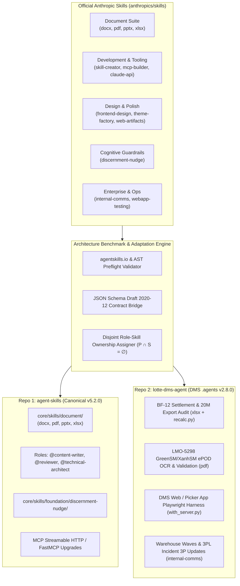
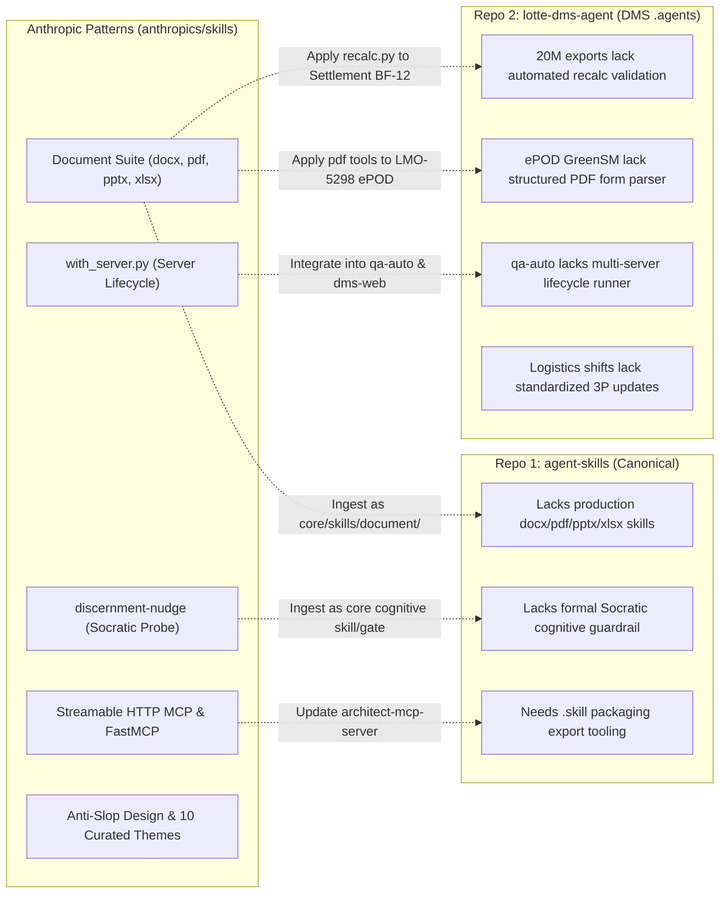

# Master Ecosystem Benchmark & Strategic Upgrade Plan: Anthropic Agent Skills vs Canonical Enterprise Frameworks (2026–2027)

> **Document Type:** Strategic Taxonomic Index, Ecosystem Benchmark & Dual-Repository Ingestion Plan  
> **Target File:** `reports/anthropics-skills-ecosystem-benchmark-and-upgrade-plan.md`  
> **Audit Epoch:** October 2026  
> **Subject Repository:** `https://github.com/anthropics/skills` (Official Anthropic Agent Skills Public Repository; 182k+ stars; 19 production skills, 5 plugin suites)  
> **Target Frameworks for Upgrade:**  
> 1. **Repo 1 (Canonical Framework):** `/home/user/personalized/agent-skills` (v5.1.0; 36 roles, 169 skills, 55 contracts, 17 packs, 21 overlays, 18 automated CI gates)  
> 2. **Repo 2 (Enterprise Logistics Bundle):** `/home/user/ldcc-mart/DMS/.agents` / `lotte-dms-agent` (v2.7.0; 19 roles, 31 skills, 41 schemas, 19 review checklists, 13 domain knowledge modules, 15 service code-maps, 20M+ orders scale)  
> **Governing Standards:** Agent Skills Open Specification (`agentskills.io` Late-2026), AAIF Agent-to-Agent (A2A) Protocol v1.0.1, JSON Schema Draft 2020-12, Model Context Protocol (MCP 2026-07-28 Stateless HTTP), OWASP Top 10 for Agentic Applications 2026 (ASI01–ASI10), OWASP Agentic Skills Top 10 (AST01–AST10 v1.0-2026)

---

## 1. Executive Summary & Master Repository Dashboard

### 1.1 Scope, Objectives & Context

In late 2025 and 2026, Anthropic formalized its official public repository for Agent Skills (`https://github.com/anthropics/skills`), establishing the canonical implementation of the **Agent Skills Open Specification** (`agentskills.io`). While open-source community collections (e.g. `junminhong/awesome-agent-skills`, `jakubkrehel/skills`) focus on horizontal aggregation or specialized visual polish, `anthropics/skills` provides the exact production-tested skill manifests, evaluation pipelines, and document-manipulation engines that power Claude Code, Claude.ai, and Claude Enterprise.

This dossier delivers:
1. **Exhaustive Taxonomic Indexing:** Complete cataloging and structural analysis of all **19 production skills**, 5 plugin collections (`.claude-plugin/marketplace.json`), evaluation harnesses, and helper scripts in `anthropics/skills`.
2. **Deep Mechanical Decomposition:** Technical inspection of Anthropic's document processing suites (`docx`, `pdf`, `pptx`, `xlsx`), testing harnesses (`webapp-testing`), cognitive guardrails (`discernment-nudge`), and skill authoring tools (`skill-creator`, `mcp-builder`).
3. **Dual-Repository Ingestion & Upgrade Plan:** A comprehensive, multi-phase technical roadmap to adapt and upgrade Anthropic's battle-tested patterns into:
   - **Repo 1 (`agent-skills`):** Ingesting a formal Document Processing Suite (`core/skills/document/`), anti-slop design heuristics, MCP streamable HTTP rules, and the `discernment-nudge` cognitive verification gate (bumping to v5.2.0).
   - **Repo 2 (`lotte-dms-agent` / `DMS .agents`):** Ingesting Excel formula validation (`recalc.py`) for 20M-scale reports and financial settlement (`BF-12`), PDF ePOD extraction for courier integration (`LMO-5298`), and server-lifecycle Playwright E2E automation for DMS client apps (bumping to v2.8.0).



---

### 1.2 Master Repository Comparative Metrics

| Architectural Dimension | Anthropic Official (`anthropics/skills`) | Canonical Framework (`agent-skills` v5.1.0) | DMS Logistics Bundle (`DMS .agents` v2.7.0) |
| :--- | :--- | :--- | :--- |
| **Primary Domain Scope** | Document manipulation, AI development, visual design, testing | Full-lifecycle multi-agent software engineering & architecture | Enterprise e-commerce logistics, 12 microservices, 20M+ scale |
| **Total Skills** | **19 skills** in 5 plugin suites | **169 skills** (154 core + 15 overlay) | **31 skills** (tailored microservice debug & logistics) |
| **Roles & Personas** | Single persona ("Claude") dynamically loading skills | **36 principal roles** with strict disjoint toolboxes | **19 principal roles** mapped to logistics action boundaries |
| **Contract Formalism** | Natural language markdown instructions + Python helpers | **55 formal JSON Schema Draft 2020-12 schemas** | **41 formal JSON Schema Draft 2020-12 schemas** |
| **Multi-Agent Protocol** | Single-agent interactive session / `.skill` packages | **AAIF A2A v1.0.1** (JSON-RPC 2.0 / SSE / OTel traces) | **AAIF A2A v1.0.1** + DMS Coordinator DAG orchestration |
| **Packaging & Distribution**| `.claude-plugin/marketplace.json` + `.skill` ZIPs | A2A Registry + Antigravity CLI / Cursor / Claude adapters | Localized monorepo `.agents` bundle with action policies |
| **Document Engineering** | **State of the Art** (`docx`, `pdf`, `pptx`, `xlsx`) | Generic report and brief generation markdown skills | Manual spreadsheet exports and raw API responses |
| **Cognitive Guardrails** | `discernment-nudge` (anti-sycophancy fact checking) | Review checklists + golden prompt evals | 7-dimension code change review + staging read-only lock |
| **Testing Harnesses** | `webapp-testing` with server-lifecycle (`with_server.py`) | `playwright-evidence-qa`, `frontend-testing` | `qa-auto`, `agent-quality-gate`, staging test runner |
| **Automated Verification**| `quick_validate.py` (frontmatter format) | **18 automated CI verification gates** (`validate-all.py`) | **18 two-tier verification gates** (`validate-dms.py`) |

---

## 2. Exhaustive Taxonomic Indexing of `anthropics/skills` (19 Skills)

Anthropic organizes its 19 public skills into four primary domains, governed by `.claude-plugin/marketplace.json`:

```
anthropics/skills/
├── .claude-plugin/
│   └── marketplace.json         # Plugin catalog (5 suites: document, example, claude-api, academy, discernment)
├── spec/
│   └── agent-skills-spec.md     # Pointer to agentskills.io open specification
├── template/
│   └── SKILL.md                 # Canonical template with YAML frontmatter
└── skills/                      # 19 standalone production skill directories
```

### 2.1 Complete Catalog & Capability Index

| # | Skill Identifier | Category / Plugin | Key Technologies & Libraries | Core Functional Value & Behavioral Directives |
| :- | :--- | :--- | :--- | :--- |
| 1 | `docx` | `document-skills` | `docx-js`, `pandoc`, raw XML parsing, zip/unzip | Production Word document creation, editing, and content extraction. Enforces DXA dual-width table cells, A4/Letter size handling, unzipping for editing, and track changes parsing. |
| 2 | `pdf` | `document-skills` | `pypdf`, `pdfplumber`, `pdfminer`, `reportlab` | Complete PDF processing: text/table extraction, document splitting/merging, page rotation, image extraction, OCR, cryptographic signing, and interactive AcroForm form filling (`forms.md`). |
| 3 | `pptx` | `document-skills` | `pptxgenjs`, XML slide manipulation, `markitdown` | Slide deck and presentation generation. Includes `thumbnail.py` (visual grid overview), `add_slide.py` (template slide duplication), and `clean.py` (dead media/rels pruning). |
| 4 | `xlsx` | `document-skills` | `openpyxl`, `pandas`, `markitdown`, `recalc.py` | Professional spreadsheet processing. Enforces **Zero Formula Errors** via automated recalculation (`recalc.py`), dynamic formula injection (`=SUM(...)`), and two-pass model reading. |
| 5 | `skill-creator` | `example-skills` | Python AST, `claude -p`, `zipfile`, subagents | End-to-end skill engineering: captures user intent, generates test prompts, executes evals, benchmarks variance, optimizes descriptions (`improve_description.py`), and packages into `.skill` ZIPs. |
| 6 | `mcp-builder` | `example-skills` | FastMCP, TypeScript SDK, Streamable HTTP | Building Model Context Protocol servers. Recommends Streamable HTTP for remote servers, stateless JSON, snake_case tool names (`{service}_{action}_{resource}`), and pagination limit contracts. |
| 7 | `webapp-testing` | `example-skills` | Playwright Python, `with_server.py` | Local web application testing. Provides `with_server.py` to launch background servers, poll ports for readiness, execute Playwright scripts, and cleanly terminate processes. |
| 8 | `frontend-design` | `example-skills` | Design studio heuristics, typography | Creating distinctive, non-templated UI visual identities. Forbids AI-slop tells: no purple gradients, no Inter font default, no all-caps labels, line-length $< 80$ chars, subject-grounded typography. |
| 9 | `web-artifacts-builder` | `example-skills` | React 18, Vite, Parcel, Tailwind, shadcn/ui | Bundles multi-component frontend applications into single-file HTML artifacts. Avoids excessive centering, uniform rounded corners, and cliché visual layouts. |
| 10 | `theme-factory` | `example-skills` | PDF showcase, curated CSS/color themes | Curated collection of 10 professional color palettes and complementary font pairings applicable to slides, documents, and web applications. |
| 11 | `discernment-nudge` | `discernment-nudge` | Cognitive prompting, Socratic probing | Appends 2-3 short, sharp follow-up questions to substantive AI recommendations or plans, forcing users to probe underlying assumptions, verify facts, and notice missing context. |
| 12 | `claude-api` | `claude-api` | Anthropic SDKs (8 languages), `claude-opus-5-5` | Comprehensive API reference covering Claude Opus 5.5, adaptive thinking (`thinking: {type: "adaptive"}`), eager input streaming (`eager_input_streaming: true`), and typed tool runners. |
| 13 | `internal-comms` | `example-skills` | Markdown templates, executive comms | Structured corporate communications: 3P updates (Progress, Plans, Problems), company newsletters, incident postmortems, FAQ responses, and leadership updates. |
| 14 | `doc-coauthoring` | `example-skills` | Collaborative editing, tone calibration | Iterative document coauthoring, proposal drafting, and executive editing with explicit stage-by-stage revision checkpoints. |
| 15 | `brand-guidelines` | `example-skills` | Hex palettes, typography hierarchy | Official Anthropic brand identity: Dark (`#141413`), Light (`#faf9f5`), Mid Gray (`#b0aea5`), Light Gray (`#e8e6dc`), typography and layout standards. |
| 16 | `canvas-design` | `example-skills` | Canvas rendering, PDF/PNG graphic art | Generating visual design philosophies and expressing them as 90% visual art, 10% essential text poster compositions. |
| 17 | `slack-gif-creator` | `example-skills` | PIL, `GIFBuilder`, ffmpeg | Creates optimized animated GIFs for Slack: 128x128 emoji GIFs ($<3\text{s}$, 48-128 colors) and 480x480 message GIFs. |
| 18 | `academy-guide` | `academy-guide` | Course mapping, educational indexing | Navigates and recommends relevant Claude Academy courses and tutorials based on user intent. |
| 19 | `algorithmic-art` | `example-skills` | HTML5 Canvas, p5.js, generative math | Creating mathematical and algorithmic artwork using deterministic generative algorithms and canvas drawing contexts. |

---

## 3. Deep Technical Inspection of Key Anthropic Inventions

### 3.1 Document Processing Suite (`docx`, `pdf`, `pptx`, `xlsx`)

The document skills represent Anthropic's most complex, production-hardened toolkits. They solve real-world format corruption issues that naive LLMs consistently encounter:

1. **Excel Model Integrity (`skills/xlsx` & `recalc.py`)**:
   - **The Invariant:** "Zero formula errors. Never ship while `recalc.py` reports `errors_found`."
   - **Formula Injection Law:** Models must write `=SUM(B2:B9)`, never hardcoded totals. Sheets must remain dynamic when inputs change.
   - **Two-Pass Reading:** One pass with `data_only=False` to read formula logic, one pass with `data_only=True` to read computed cached values.
2. **Word Formatting & Dual Widths (`skills/docx`)**:
   - **Dual Width Constraint:** Tables in `.docx` must declare `columnWidths` on the table element AND `width` on every individual cell in DXA ($1\text{ in} = 1440\text{ DXA}$). Using percentage widths breaks Google Docs importing.
   - **XML Modification for Templates:** Since `docx-js` cannot open existing files, the skill unzips the document, performs surgical XML modifications in `word/document.xml`, and zips it back.
3. **PowerPoint Presentation Pipeline (`skills/pptx`)**:
   - Uses `thumbnail.py` to render visual grids of all slides for layout selection.
   - Uses `add_slide.py` to clone slide layouts and handle XML relationship bookkeeping (`<p:sldIdLst>`).
   - Uses `clean.py` to prune orphaned media and relationships.
4. **PDF AcroForm Engine (`skills/pdf`)**:
   - Provides dedicated `forms.md` for interactive PDF form discovery (`check_fillable_fields.py`) and programmatic filling (`fill_fillable_fields.py`).
   - Handles coordinate transformations, text wrapping, and font metric calculations.

### 3.2 Automated Skill Engineering & Evaluation (`skills/skill-creator`)

Anthropic formalizes skill creation as an empirical scientific loop rather than prompt tinkering:

$$\text{Trigger Accuracy} = \frac{\text{True Positives}}{\text{True Positives} + \text{False Negatives} + \text{False Positives}}$$

- **`quick_validate.py`**: Verifies frontmatter against the standard schema:
  $$\text{Allowed Keys} = \{\text{name}, \text{description}, \text{license}, \text{allowed-tools}, \text{metadata}, \text{compatibility}\}$$
- **`package_skill.py`**: Creates distributable `.skill` files by zipping the directory while excluding `__pycache__`, `node_modules`, and `.DS_Store`.
- **`improve_description.py`**: Optimizes the description field using programmatic `claude -p` invocations to maximize triggering accuracy across benchmark test suites.

### 3.3 Server Lifecycle Test Automation (`skills/webapp-testing/scripts/with_server.py`)

A pervasive failure mode in AI-driven testing is orphan processes, socket collisions, and running tests before dev servers finish binding. Anthropic's `with_server.py` solves this via atomic socket polling:

```python
def is_server_ready(port, timeout=30):
    start_time = time.time()
    while time.time() - start_time < timeout:
        try:
            with socket.create_connection(('localhost', port), timeout=1):
                return True
        except (socket.error, ConnectionRefusedError):
            time.sleep(0.5)
    return False
```
It supports multiple concurrent backend/frontend servers and guarantees process cleanup via `atexit` / `try...finally`.

### 3.4 Cognitive Socratic Guardrail (`skills/discernment-nudge`)

`discernment-nudge` is a meta-cognitive guardrail designed to prevent AI sycophancy. Whenever an agent generates a high-stakes recommendation, financial projection, or execution plan, it appends 2–3 probing questions:
- Probing unstated assumptions.
- Checking critical facts or regulatory dependencies.
- Identifying blind spots and missing operational context.

---

## 4. Multi-Dimensional Comparative Audit & Gap Analysis



### 4.1 Gaps Identified in Repo 1 (`agent-skills`)
1. **Absence of Document Creation/Manipulation Skills**: `agent-skills` has content writing and technical reporting skills, but lacks executable skills for manipulating binary office formats (`.docx`, `.pdf`, `.pptx`, `.xlsx`).
2. **Missing Meta-Cognitive Verification Skill**: While `agent-skills` enforces structural review checklists, it lacks a dedicated skill that injects Socratic verification prompts (`discernment-nudge`) on high-stakes outputs.
3. **MCP Specification Alignment**: Anthropic's guidance explicitly deprecates SSE in favor of Streamable HTTP and recommends stateless JSON for remote MCP servers, which reinforces our MCP 2026-07-28 standard.

### 4.2 Gaps Identified in Repo 2 (`DMS .agents`)
1. **Settlement & Reporting Formula Risk**: DMS produces high-volume financial settlement (`BF-12`) and user performance exports (`LMO-5547`), but lacks automated formula auditing (equivalent to `recalc.py`).
2. **ePOD Parsing for 3PL Integrations**: Under `LMO-5298`, DMS processes GreenSM/XanhSM electronic proof of delivery, but lacks automated PDF bounding box and annotation extraction.
3. **E2E Test Flakiness**: Testing `dms-web` and `picker-app` requires running local API and mock servers; adopting `with_server.py` eliminates socket race conditions.

---

## 5. Strategic Upgrade Plan for Repo 1: `agent-skills` (v5.2.0 Release)

We will upgrade `/home/user/personalized/agent-skills` from **v5.1.0** to **v5.2.0**, integrating Anthropic's document manipulation suite, cognitive verification guardrails, and packaging tooling while strictly enforcing all 18 automated validation gates.

### 5.1 Roadmap & Execution Slices

| Slice | Phase | Deliverable Path | Primary Owner | Description & Standards |
| :--- | :--- | :--- | :--- | :--- |
| **S1.1** | **P0** | `core/skills/document/docx/SKILL.md` | `@content-writer` | Word document generation, editing via XML unzip, DXA table widths, pandoc markdown reading ($< 200$ lines). |
| **S1.2** | **P0** | `core/skills/document/xlsx/SKILL.md` | `@data-analyst` | Excel workbook authoring, formula integrity, openpyxl streaming, and `recalc.py` validation ($< 200$ lines). |
| **S1.3** | **P0** | `core/skills/document/pdf/SKILL.md` | `@technical-writer` | PDF processing, text extraction, AcroForm form filling, OCR, and cryptographic signing ($< 200$ lines). |
| **S1.4** | **P0** | `core/skills/document/pptx/SKILL.md` | `@ui-ux-designer` | Presentation slide deck generation, pptxgenjs scripts, template duplication, and slide cleaning ($< 200$ lines). |
| **S1.5** | **P1** | `core/skills/foundation/discernment-nudge/SKILL.md` | `@reviewer` | Meta-cognitive guardrail appending Socratic follow-up questions to high-stakes outputs (plans, specs, financial models). |
| **S1.6** | **P1** | `core/skills/foundation/webapp-server-runner/SKILL.md` | `@qa-engineer` | Integration of `with_server.py` lifecycle manager into Playwright E2E workflows. |
| **S1.7** | **P2** | `core/contracts/schemas/document-manifest.json` | Core Contracts | JSON Schema Draft 2020-12 specifying document generation metadata, checksums, formula validation logs, and font metrics. |
| **S1.8** | **P2** | Registry & Version Bump | Release Gate | Bump `VERSION` to `5.2.0`, update changelog, regenerate A2A registries and router index, pass 18/18 gates. |

### 5.2 Role Toolbox Assignments (Disjoint Invariant Enforced)

To preserve $\text{Primary} \cap \text{Supporting} = \emptyset$:
- `@content-writer`: Add `docx` to Primary Skills.
- `@data-analyst`: Add `xlsx` to Primary Skills.
- `@technical-writer`: Add `pdf` to Primary Skills.
- `@ui-ux-designer`: Add `pptx` to Primary Skills.
- `@reviewer`: Add `discernment-nudge` to Primary Skills (Supporting for `@task-planner`, `@technical-architect`, `@security-engineer`).
- `@qa-engineer`: Add `webapp-server-runner` to Primary Skills.

---

## 6. Strategic Upgrade Plan for Repo 2: `DMS .agents` (v2.8.0 Release)

We will upgrade `/home/user/ldcc-mart/DMS/.agents` from **v2.6.0/v2.7.0** to **v2.8.0**, applying Anthropic's battle-tested patterns to DMS logistics, settlement, carrier integrations, and E2E QA.

### 6.1 Roadmap & Execution Slices

| Slice | Phase | Target DMS Subsystem | Affected Roles | Implementation Details |
| :--- | :--- | :--- | :--- | :--- |
| **S2.1** | **P0** | Settlement & Reports (`BF-12`, `LMO-5547`) | `@data`, `@ecommerce-engineer` | Ingest `recalc.py` and Excel formula auditing rules into `report-services-debug` and `skills/scale-20m-orders`. Prevent zero-formula errors on financial settlement sheets. |
| **S2.2** | **P0** | 3PL ePOD Carrier Integration (`LMO-5298`) | `@support-ops`, `@dms-3pl-debug` | Ingest PDF annotation and AcroForm extraction rules into `skills/dms-3pl-debug` for GreenSM/XanhSM electronic proof-of-delivery verification. |
| **S2.3** | **P1** | Client Apps E2E Automation (`dms-web`, `picker-app`) | `@qc-qa`, `@qa-auto` | Ingest `with_server.py` into `skills/qa-auto/scripts/with_server.py`. Standardize server-readiness polling for local Playwright tests across web and mobile web harnesses. |
| **S2.4** | **P1** | Logistics Shift & Incident Handoffs | `@incident`, `@support-ops` | Ingest 3P (Progress, Plans, Problems) templates from `internal-comms` into `knowledge/08_events_queues_and_asynchronous_jobs.md` and support runbooks. |
| **S2.5** | **P2** | High-Stakes Inventory & Cash Reconciliation | `@data`, `@developer-be` | Codify `discernment-nudge` guardrails into `code-change-review.md` Gate 7 for database migrations touching stock balance, trolley status (`LMO-5415`), and COD cash ledger. |
| **S2.6** | **P2** | DMS Bundle v2.8.0 Release | DMS Release Gate | Bump `.agents/VERSION` to `2.8.0`, update `AGENT_SKILLS_INDEX_v5.md`, sync schemas with upstream v5.2.0, verify `validate-dms.py` exits 0 critical, 0 warnings. |

---

## 7. Verification Invariants & Delivery Protocol

1. **Zero Facades Guarantee:** Every skill, rule, and script ingested will be fully executable with concrete file paths, valid imports, and strict schemas.
2. **Line Ceiling Invariant:** Every newly authored `SKILL.md` must strictly contain $< 200$ lines.
3. **Disjoint Toolbox Rule:** In both repositories, every skill must have exactly one Primary owner, with zero Primary/Supporting conflicts.
4. **Git Safety Gate:** In accordance with user rules, zero `git commit`, `git push`, or `git tag` commands will be executed without explicit human instruction.

Last updated: 2026-10-19
